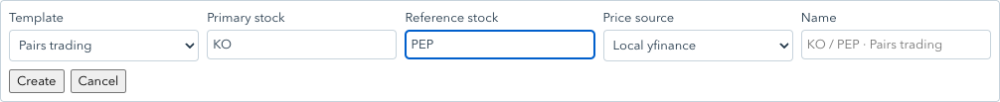
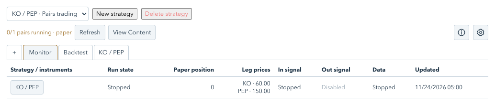
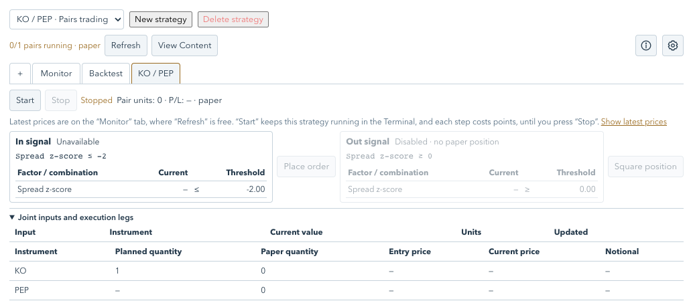

# Chapter 1. Watch your first pair of stocks

[繁體中文](../zh-TW/01-watch-your-first-pair.md) · [简体中文](../zh-CN/01-watch-your-first-pair.md) · English · [Contents](../README.md)

Two stocks rose today. Did they rise by the same amount in percentage terms? In this chapter, you'll use Strategy Monitor in Retis Terminal to compare two U.S. stocks, Coca-Cola and PepsiCo, and find their prices and signals on the screen. Allow about 15 minutes. You can start here even if you've never bought a stock.

## Read a ticker and a share price

A share of stock represents a small piece of ownership in a company. The price of a share can change as people trade it. A **ticker** is the short code you use to look up a stock. This tutorial uses the codes shown in Strategy Monitor.

| Company | Ticker shown | Role in the example |
| --- | --- | --- |
| Coca-Cola | `KO` | Primary stock |
| PepsiCo | `PEP` | Reference stock |

Start with two imaginary prices. Stock A rises from 100 to 110, a gain of 10 ÷ 100 = **10%**. Stock B rises from 50 to 52, a gain of 2 ÷ 50 = **4%**. Both stocks rose, and A gained more in percentage terms. Use each stock's starting price when you calculate its percentage change.

**Pairs trading** looks at how two stocks move relative to each other. A strategy defines a way to measure the gap between them and uses rules to decide when to enter or exit. Our example enters by buying one stock and shorting the other. To short a stock, a trader borrows shares, sells them, and later buys shares back to return. The gap can narrow or continue to widen, so knowing that both stocks rose tells you only part of the trade's story.

## Create the example pair

1. Sign in to **Retis Terminal** on your computer and open **Strategy Monitor** from the Getting Started workspace. You can also search for it from **New Data Browser** in the sidebar. See [First run](../../../../docs/en/first-run.md) for help signing in.
2. Click **New strategy** and choose **Pairs trading**. Enter `KO` as the **Primary stock** and `PEP` as the **Reference stock**.
3. Select **Local yfinance** as the **Price source**, then click **Create**.

*Figure 1-1. Check both U.S. tickers and the price source before you create the pair.*

> **If Local yfinance isn't listed**, open Retis MAS Manager from **New Data Browser → On this computer**. Install **Local yfinance** and wait for it to show that it's running. Then return to Strategy Monitor. A compatible price history source that covers both U.S. tickers also works. [Local yfinance setup](../../../../docs/en/local-yfinance.md)

## Read the Monitor tab

Stay on **Monitor** and click **Refresh**. Find the `KO / PEP` row and read both prices and the run state. Creating the strategy and refreshing prices use zero points. Strategy Monitor uses simulated trades, also called paper trades. This chapter only calls for observing the screen.

*Figure 1-2. The Leg prices column shows both stocks. Stopped means the strategy is currently inactive. The date and prices are sample data.*

The price is the most recent value your source can supply. After the market closes, the last available price may be from an earlier session. If a cell shows “—”, check your price source and data status. Write down the dash separately from a numeric zero. It means the screen has no value to show for that cell.

### Open the individual pair tab

Click **KO / PEP**. This tab shows the pair's paper positions, signals, and data inputs. A **position** is the amount currently held. A **signal** shows whether a strategy condition is met. Find these fields and leave the example stopped.

*Figure 1-3. The pair tab shows paper positions and entry and exit signals. Some cells are blank or show a dash while the strategy is stopped.*

| Tab | Use it to |
| --- | --- |
| Monitor | Scan your pairs, prices, and run states. |
| Individual pair | Inspect one pair's positions, signals, and data inputs. |
| Backtest | Simulate the strategy on historical prices. You'll practise this in a later chapter. |

## Exercise. Read what you see

1. Write down the tickers, prices, and run state for the primary and reference stocks. If you can't retrieve prices, use Figure 1-2 and label the values “sample data.”
2. Switch from Monitor to the pair tab. Find **In signal** and **Out signal**, then return to Monitor. Explain what you'd use each tab for.
3. Suppose Coca-Cola rises from $60 to $61.20 and PepsiCo rises from $150 to $151.50. Which stock gains more in percentage terms? Divide each price increase by its starting price.

Check your answers

1. In Figure 1-2, the primary stock is Coca-Cola, `KO`, at $60. The reference stock is PepsiCo, `PEP`, at $150. The strategy is stopped. Your refreshed prices may differ.
2. Monitor is for scanning the overall status. The individual pair tab is for inspecting its positions, signals, and data inputs.
3. Coca-Cola gains 1.20 ÷ 60, or **2%**. PepsiCo gains 1.50 ÷ 150, or **1%**. Coca-Cola has a smaller dollar increase and a larger percentage gain.

In the next chapter, you'll use a simple trade table to work out the profit or loss on the long and short positions, then add the two together.

*Screenshots show the English Strategy Monitor interface with isolated sample data.*
