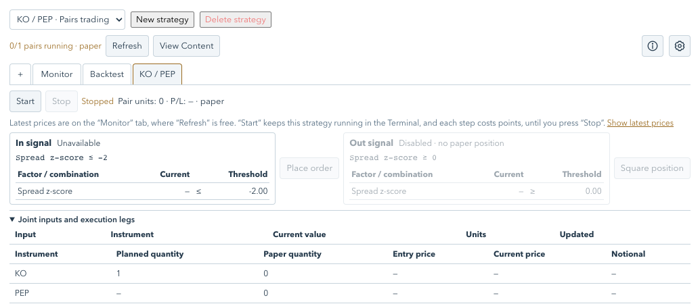

# Chapter 2. Buying, short selling, and profit

[繁體中文](../zh-TW/02-long-short-and-profit.md) · [简体中文](../zh-CN/02-long-short-and-profit.md) · English · [Edition contents](README.md)

A pairs trade has two legs. On the **long** leg, you buy shares and later sell them. The long leg gains when the price rises. On the **short** leg, a trader borrows shares, sells them, then buys shares back to return. The short leg gains when the price falls and loses when the buyback costs more than the original sale. Real short selling can incur borrowing costs and losses can grow as the price keeps rising.

Write positive quantities for long positions and negative quantities for short positions. For one closed leg, gross P&L (profit and loss) is **(exit price − entry price) × signed quantity**. For a stock example, the multiplier is 1. Add the two legs for the trade’s gross P&L.

| Fictional leg | Signed shares | Entry | Exit | Gross P&L |
| --- | ---: | ---: | ---: | ---: |
| Primary | +1 | \$100 | \$108 | +\$8 |
| Reference | −2 | \$50 | \$53 | −\$6 |
| Pair | | | | **+\$2** |

Both stocks rose. The long leg gained \$8 and the short leg lost \$6. If the reference had risen to \$58, the second leg would have lost \$16 and the pair would have lost \$8. There is a loss scenario even with roughly equal dollar exposure at entry.

### In Strategy Monitor

Open the **KO / PEP** pair tab from Chapter 1. Find **Paper quantity** for both stocks and the **In signal** and **Out signal** panels. Keep the strategy stopped. A quantity of zero means that leg is flat. Later, a paper fill will show a simulated entry price and quantity. A signal shows whether a condition is satisfied. You need a recorded fill to calculate P&L from a trade.

*Figure 2-1. The positions table identifies both legs and lets you distinguish zero quantity from a price that is still unavailable.*

### Exercise

Start again with one share long at \$100 and two shares short at \$50. At exit the stocks are \$97 and \$46. Calculate the two legs and the combined result. How much remains after \$2 of total costs?

Check your answer

Long P&L is −\$3. Short P&L is `(46 − 50) × (−2) = +$8`. Gross P&L is \$5 and P&L after the assumed costs is \$3.

---

[Previous · Watch your first pair of stocks](01-watch-your-first-pair.md) · [Edition contents](README.md) · [Next · Why trade a pair?](03-why-trade-a-pair.md)
