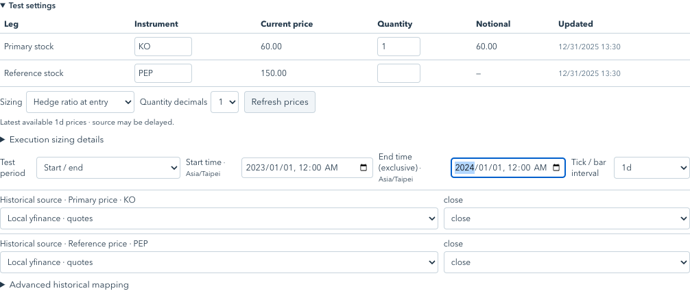

# Chapter 4. Get and check prices

[繁體中文](../zh-TW/04-get-and-check-prices.md) · [简体中文](../zh-CN/04-get-and-check-prices.md) · English · [Edition contents](README.md)

Strategy Monitor needs a source for both legs. The **Monitor** tab displays the latest available observations. **Backtest** uses a historical source and its mapping for each leg. A **mapping** tells the app which provider field has the price and which field has the timestamp. The latest price and the historical close can come from different settings.

For this edition use **Local yfinance** with `KO` and `PEP`. If it is unavailable, follow the setup guide or select a compatible source with daily history for both. [Local yfinance setup](../../../../docs/en/local-yfinance.md)

| Daily field or condition | How to handle it |
| --- | --- |
| Close | Price at the end of the observation period, as provided by the source. |
| Adjusted close | Price series adjusted for corporate actions according to the source’s method. Use the same convention on both legs and record it. |
| Missing bar | Check market holidays, ticker spelling and the provider's date coverage. A missing price cannot be entered as zero. |
| Price timestamp | Check the displayed time zone and the observation date. Refreshing after the market closes can still return the last session. |

### In Strategy Monitor

1. On **Monitor**, click **Refresh** and record both prices and **Updated**. Compare the two dates before interpreting the row.
2. Open **Backtest → Manual** and expand **Test settings**. Locate both historical inputs and the interval. Choose daily observations where available. Record the provider and exact price field for each leg. Follow the source’s published defaults unless you have a reason to change them.
3. Compare the settings against your experiment note. If one leg is adjusted and the other is raw, revisit the mapping before testing. A split or distribution can otherwise create a gap that is an artifact of the input convention.

*Figure 4-1. Historical mappings describe both legs. In the lab, verify each one before running a test.*

### Exercise

You see a sharp change in the spread on a day when one stock split. What do you check? What if one stock has no timestamp on a date when the other traded?

Check your answer

Check both fields and the provider’s adjustment policy. Use a consistent convention and repeat the same test. For a missing timestamp, check the listings, calendar and source data and record the missing observation. Leave that date unavailable unless you have a defensible alignment policy.

---

[Previous · Why trade a pair?](03-why-trade-a-pair.md) · [Edition contents](README.md) · [Next · Build a weighted spread](05-build-a-weighted-spread.md)
