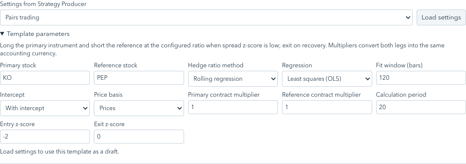

# Chapter 5. Build a weighted spread

[繁體中文](../zh-TW/05-build-a-weighted-spread.md) · [简体中文](../zh-CN/05-build-a-weighted-spread.md) · English · [Edition contents](README.md)

A **spread** is a number that represents the gap between the legs. For the book’s first fixed-ratio lab, use **spread = primary price − ratio × reference price**, with a multiplier of 1 on each leg. The **signal hedge ratio** is the weight in that formula. If the instruments have contract multipliers, multiply each price by its own multiplier before applying the ratio.

| Observation | Primary | Reference | Spread at ratio 2 |
| --- | ---: | ---: | ---: |
| A | 100 | 50 | 0 |
| B | 96 | 49 | −2 |
| C | 108 | 53 | +2 |

A move from B to C is a spread increase of 4. With a fixed long quantity of one and a fixed short quantity of two, the gross P&L across those two rows is also 4. That shortcut depends on using the same quantities as the signal weights, the same multiplier, and observed prices without costs. Changing your sizing can change P&L while leaving the signal exactly as it was.

### In Strategy Monitor

1. Keep the **KO / PEP** example stopped. Open the gear, choose **Pairs trading** under **Settings from Strategy Producer**, and check both tickers.
2. Select **Fixed ratio** and use **Prices** as the basis. As a teaching baseline, divide the primary by the reference using an observation known before the test. With Chapter 1’s toy prices this is `60 ÷ 150 = 0.4`. For your own run, record when you observed the prices used for the ratio. Keep both stock multipliers at 1.
3. Click **Load settings** and then **Apply configuration**. In a later backtest, open **Lines** and select **Hedged spread**. Read a day’s two prices and compare your hand calculation with the chart.

*Figure 5-1. The template can estimate a hedge ratio. Choose Fixed ratio for this hand-calculation lab.*

### Exercise

At a fixed ratio of 0.4, what is the spread at primary \$61.20 and reference \$151.50? Does a positive spread guarantee an exit?

Check your answer

`61.20 − 0.4 × 151.50 = 0.60`. The example exits by comparing the **z-score** with its exit threshold. A positive raw spread can still be below its recent average.

---

[Previous · Get and check prices](04-get-and-check-prices.md) · [Edition contents](README.md) · [Next · Read the spread z-score](06-read-the-z-score.md)
