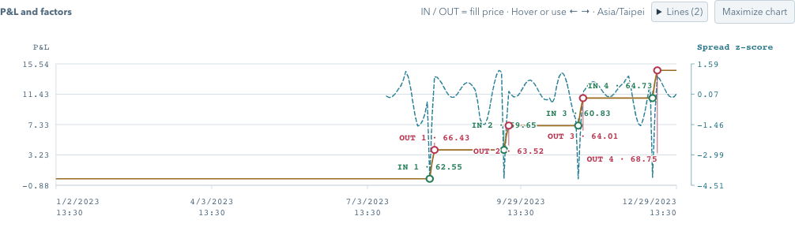

# Chapter 6. Read the spread z-score

[繁體中文](../zh-TW/06-read-the-z-score.md) · [简体中文](../zh-CN/06-read-the-z-score.md) · English · [Edition contents](README.md)

A spread of −2 can be large for one pair and small for another. The **z-score** describes the spread in units of its recent variability:

> z = (current spread − rolling mean) ÷ rolling standard deviation

The rolling window contains the latest **N observations**, including the current one. The pairs template uses population standard deviation for this calculation. With four toy spreads `10, 12, 14, 8`, the mean is 11. The squared differences from 11 are 1, 1, 9 and 9. Their average is 5, so the standard deviation is about 2.24. The last spread’s z-score is `(8 − 11) ÷ 2.24 ≈ −1.34`.

With an entry threshold of −2, −1.34 does not meet the entry condition. With an open position and an exit threshold of 0, −0.10 still falls short of the exit level, while +0.10 satisfies it. The template uses **≤** for entry and **≥** for exit. A low z-score tells you where the spread sits in a recent window. It gives no probability that the spread will recover.

### In Strategy Monitor

Open a completed backtest (see [Chapter 8](08-run-a-manual-backtest.md) for the steps). In **Lines**, turn on **Spread z-score** and optionally **Hedged spread**. Move across the chart to read both values at the same timestamp. Look for gaps before the first z-score and after missing inputs. The calculation needs a complete window and nonzero variation. With a rolling hedge estimate, usable spread values also need hedge warm-up before the z-score can complete.

*Figure 6-1. Use the crosshair to find the observation, read the z-score and compare it with the entry and exit thresholds. The series is synthetic.*

### Exercise

The rules are entry ≤ −2 and exit ≥ 0. The strategy is flat and the next available z-scores are −1.8, −2.0, −2.4, −0.2, and 0.0. Identify the entry and exit assuming valid prices and executable sizing. What happens if the first eligible value is missing?

Check your answer

Entry is at −2.0, and exit is at 0.0. The −2.4 observation does not add a second position. A missing z-score cannot satisfy the entry rule.

---

[Previous · Build a weighted spread](05-build-a-weighted-spread.md) · [Edition contents](README.md) · [Next · Build and freeze a strategy](07-build-a-baseline-strategy.md)
