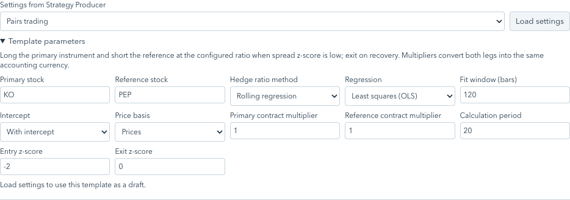

# Chapter 7. Build and freeze a strategy

[繁體中文](../zh-TW/07-build-a-baseline-strategy.md) · [简体中文](../zh-CN/07-build-a-baseline-strategy.md) · English · [Edition contents](README.md)

A reproducible rule specifies the input pair, spread calculation, conditions that change a position, and execution sizing. Record them before comparing outcomes. A saved rule provides a baseline you can repeat and explain.

| Baseline setting | Teaching choice |
| --- | --- |
| Instruments | Primary `KO`, reference `PEP` |
| Data | Same provider and daily price convention on both legs |
| Spread | Prices, fixed ratio from a prior observation, multipliers 1 |
| Calculation period | 20 observations |
| Entry and exit | Enter when z ≤ −2, exit when z ≥ 0 |
| Direction | Long primary, short reference on a valid entry |

These thresholds describe the course experiment. A gap can keep widening, so a recovery rule alone has no guarantee of getting you out promptly. The template works in one direction. Reversing the trade direction alone leaves the original signal logic in place.

### In Strategy Monitor

1. Open **Strategy settings** with the gear while the strategy is stopped. First inspect the saved calculations and signals. Selecting a template shows its parameters, which can start at defaults. Reenter the pair order and parameters you intend to keep.
2. Select **Pairs trading**, set the documented baseline, and click **Load settings**. Inspect the draft for both source instruments, hedge method, calculation period and entry/exit operators. Loading a draft and saving it are separate steps.
3. Click **Apply configuration** and reopen **View Content** or settings to verify the saved rule. Give the strategy a name that distinguishes this baseline from later experiments. Use a separate strategy or write down the revision before you change a parameter.

*Figure 7-1. This screenshot shows the template default, Rolling regression. Choose Fixed ratio for this chapter. Load settings puts the choices into a draft, then Apply configuration saves it.*

### Exercise

Say the entry threshold is −1.5 and the exit is −2. Which condition would a z-score of −1.8 satisfy? Why does the template require entry below exit?

Check your answer

−1.8 satisfies both conditions: it is below −1.5 and above −2. A lower entry than exit separates the trigger from the recovery level. Restore −2 and 0 for the baseline.

---

[Previous · Read the spread z-score](06-read-the-z-score.md) · [Edition contents](README.md) · [Next · Run a manual backtest](08-run-a-manual-backtest.md)
