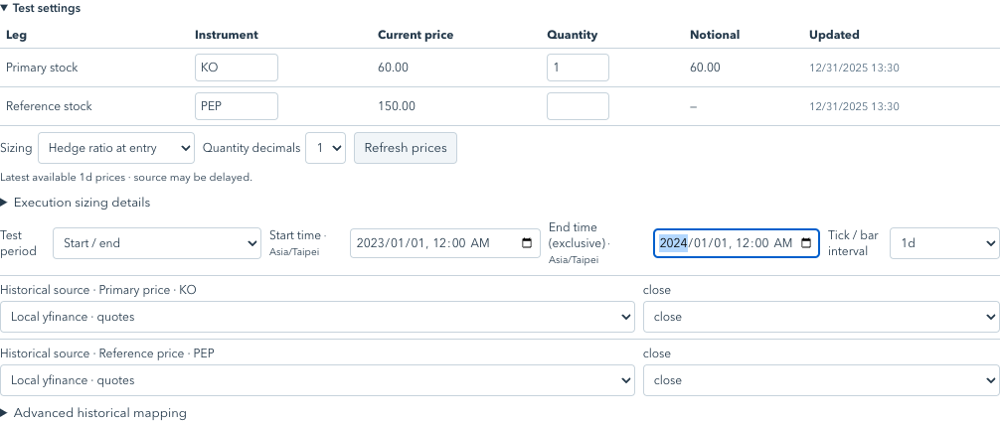

# Chapter 8. Run a manual backtest

[繁體中文](../zh-TW/08-run-a-manual-backtest.md) · [简体中文](../zh-CN/08-run-a-manual-backtest.md) · English · [Edition contents](README.md)

A **backtest** replays a saved rule on historical observations. It answers what the simulator would have done under the supplied data and fill assumptions. This is the first test of a rule you wrote before opening the report.

### In Strategy Monitor

1. Open **Backtest → Manual** and expand **Test settings**. Confirm the primary and reference stocks, daily interval, historical sources and price fields. Start with several months of supported daily data and more observations than your warm-up needs. Write down the requested dates and time zone.
2. Choose **Start / end**. The start is included and the end is excluded. To include the last intended session, place the end after its observation. The count modes use actual data rows rather than calendar days. Holidays and gaps can make two date ranges with the same length contain different counts.
3. Choose a sizing policy and keep it fixed for the trial. For the first run, select **Fixed quantities** under **Sizing** and enter 5 primary shares and 2 reference shares. Enter both as positive amounts. The template applies the direction. Check the quote for point usage where shown, then press **Run backtest**.
4. Compare the requested range to the observed range. Check observations, warm-up, closed trades and open positions. Note the first entry timestamp and both leg prices, or the reason there were no entries.
5. Click **Save backtest**. Reopen it from the saved report list. Use **Download report** if you want a copy of the frozen report for your journal. Save before running another test. A new run can replace the unsaved result.

*Figure 8-1. The screenshot shows the initial sizing choice. Select Fixed quantities for the exercise, then check both symbols and historical fields. The pictured period is for synthetic fixture data.*

### What to record

The simulator can fill at the observed price used in the replay. A real order following a close-based signal may only be possible later and at a different price. Record this as a limitation and compare results under less favorable prices or separate cost assumptions. The report can mark an open position at the last observed price. Check the status before treating its P&L as realized.

### Exercise

Your test requests 20 calendar days, starts flat and looks for a 20-observation z-score. You see 14 daily observations and no trades. What do you investigate?

Check your answer

The z-score may never have warmed up. Check holidays and both input mappings, then run a period with more valid paired observations. If the z-score is ready and never reaches the threshold, record that as a genuine no-entry result.

---

[Previous · Build and freeze a strategy](07-build-a-baseline-strategy.md) · [Edition contents](README.md) · [Next · Read a backtest report](09-read-a-backtest-report.md)
