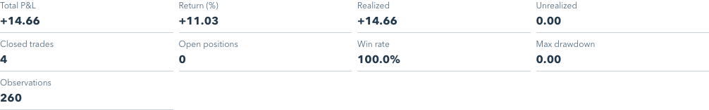

# Chapter 9. Read a backtest report

[繁體中文](../zh-TW/09-read-a-backtest-report.md) · [简体中文](../zh-CN/09-read-a-backtest-report.md) · English · [Edition contents](README.md)

Start with trade counts and data coverage. A report with two trades and one large gain tells a different story from a report with many small gains. Both deserve a close look at where losses occurred and what was still open.

| Result | What it measures |
| --- | --- |
| Realized P&L | P&L from closed trades. |
| Unrealized P&L | P&L marked on positions still open at the end. |
| Total P&L | Realized plus unrealized P&L under the report’s cost model. |
| Win rate | Winning closed trades divided by closed trades, including breakevens in the denominator. |
| Maximum drawdown | Largest drop from a previous cumulative P&L peak, counting the initial zero. |
| Return shown | Total P&L divided by the denominator named in the tooltip. |

The normal manual summary can use **peak capital tied up**. A margined leg can use its recorded margin and an unmargined leg its full entry value. The Automatic batch return statistics use **peak simultaneous gross entry notional**. Check tooltips for the report and line you are reading, especially when margin is configured. Neither number annualizes the result.

*Figure 9-1. Start with observations and trade counts, then examine P&L and drawdown. The report was computed from synthetic prices.*

### In Strategy Monitor

1. Open the saved result. Find one closed trade and check both leg quantities, the entry and exit timestamps, and the P&L column.
2. In the P&L chart, find its matching **IN** and **OUT** markers. Follow the curve between them. A winning trade can spend much of its life in a drawdown.
3. Look for an open trade without an OUT. Note how much of total P&L comes from the open position. If no return is shown, check whether valid entry capital exists.
4. Find the cost model and compare the result with and without costs only when the two runs share the same rule, period and sizing.

### Exercise

The cumulative P&L path is 0, +20, +8, +25, +6. The final report shows realized +10 and unrealized −4. What are total P&L and maximum drawdown? If the reported denominator is \$200, what is the displayed return?

Check your answer

Total P&L is +6. The biggest peak-to-later-low drop is 25 − 6 = 19. Return is 6 ÷ 200 × 100 = **3%** under the given denominator.

---

[Previous · Run a manual backtest](08-run-a-manual-backtest.md) · [Edition contents](README.md) · [Next · Size positions and account for costs](10-position-sizing-and-costs.md)
