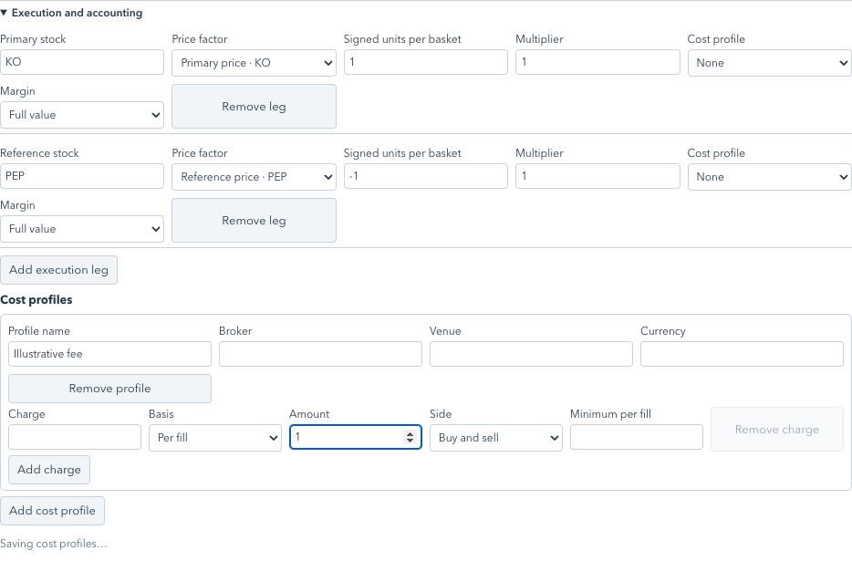

# Chapter 10. Size positions and account for costs

[繁體中文](../zh-TW/10-position-sizing-and-costs.md) · [简体中文](../zh-CN/10-position-sizing-and-costs.md) · English · [Edition contents](README.md)

The **signal ratio** weights the input prices. **Position sizing** determines how many units actually participate in P&L. It depends on the backtest mode and the recorded fills.

| Backtest sizing | What to check |
| --- | --- |
| Fixed quantities | The primary and reference amounts are entered explicitly. |
| Balance at entry prices | The reference amount is computed at entry to approximate the primary dollar exposure, subject to rounding and multipliers. |
| Hedge ratio at entry | When available for the strategy, sizes the reference leg using estimated reference units per primary unit at the entry observation. |

At \$60 for the primary and \$150 for the reference, five primary shares have \$300 of entry value. Two reference shares have \$300 too. The signed quantities +5 and −2 give gross entry notional of \$600. Balancing dollars does not remove company-specific losses, fill risk or exposure that changes after entry. The simulated quantities may also differ from a broker’s supported lot size.

### In Strategy Monitor

1. Run the same saved rule in two manual tests with different **Sizing** settings. Keep the period and fields unchanged. Compare quantities, gross exposure and P&L on a trade that appears in both. If one mode has no matching trade, record that difference.
2. To isolate the effect of a commission, save a no-cost baseline and keep sizing fixed. In a stopped practice strategy, open **Strategy settings → Execution and accounting**. If offered, choose **Add cost profile**. Name it “Illustrative fee,” choose **Per fill**, enter 1 as the amount, and select **Buy and sell**. These are made-up charges for the exercise.
3. Select the new **Cost profile** on both legs and **Apply configuration**. Rerun the same period. Compare the cost and P&L fields. A saved cost profile affects the strategy once you select it on a leg and apply the configuration.
4. Record the applied settings and the report’s cost model. Estimate unmodeled borrowing or slippage separately. Use the report’s cost breakdown to avoid counting a charge twice.

*Figure 10-1. The sample profile defines a charge of 1 per fill. Assign it to both legs as a separate step.*

Spread crossing at the same observed close can be optimistic. Slippage is the gap between the price used for a decision and the price you can actually get. Separate fills for the two legs can also leave you temporarily exposed. A paper test can help you identify these issues even when it cannot fully model them.

### Exercise

A round trip yields \$12 gross. Four fills cost \$1 per fill. Estimated total slippage is \$3 and estimated borrow cost is \$2. What remains? What if the report has already deducted the \$4 fee?

Check your answer

Net estimate is `12 − 4 − 3 − 2 = $3`. If fees are already deducted, start at \$8 and subtract only slippage and borrow cost that remain unmodeled.

---

[Previous · Read a backtest report](09-read-a-backtest-report.md) · [Edition contents](README.md) · [Next · Test a rule on unseen periods](11-test-unseen-periods.md)
