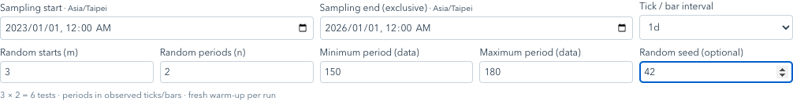
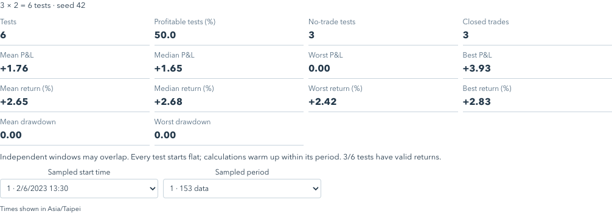

# Chapter 11. Test a rule on unseen periods

[繁體中文](../zh-TW/11-test-unseen-periods.md) · [简体中文](../zh-CN/11-test-unseen-periods.md) · English · [Edition contents](README.md)

Use a **formation period** to choose the pair, weight, and parameters. Freeze them before running on a later **holdout period**. The point of a holdout is to learn how a chosen rule behaves on data that had no role in its selection. Repeatedly fixing the rule after reviewing its holdout results turns that period into formation data. Use a fresh later period if you do that.

### In Strategy Monitor

1. Pick two chronological, non-overlapping ranges accessible to the same provider. Record exact bounds and ensure each has adequate warm-up. Run the formation test and save it.
2. Write the rule down. Run **Manual** on the later period with the same rule, fields, sizing and costs. Compare trade counts, drawdown and P&L. Record any performance that depended on one fill or one event.
3. Open **Automatic** to explore window sensitivity. As a small lab use **m = 3**, **n = 2**, a feasible length range (for example 150–180 daily observations with enough history), and seed **42**. Choose sampling bounds that leave enough observed rows for the longest test. Click **Run automatic backtest** and save the batch. Keep the seed, date bounds and historical snapshot for reproduction.
4. Read profitable-test count, no-trade count, median P&L and worst drawdown. Use the sampled start/period selectors to open a good and a weak test. Find one reason for the difference.

*Figure 11-1. Three sampled starts crossed with two sampled lengths produce six tests. Each starts flat and warms up within its window.*

*Figure 11-2. Use the spread of results and window details to see where the baseline struggles. This batch uses synthetic data.*

Automatic windows can overlap. Treat their results as separate experiments and do not add or compound their returns into a portfolio result. A seed resamples the same choices only with matching data and settings. No-trade windows contribute zero to P&L statistics and have an unavailable return. Use the individual window rows to spot that distinction.

### Exercise

Your six windows show two profitable tests, two losing tests and two with no entries. What denominator do you use for the profitable-test rate? Can you count the overlapping windows as six independent confirmations?

Check your answer

Use all six tests: 2 ÷ 6 ≈ **33.33%**. The two no-entry tests produce no valid return percentage. Overlap reuses observations, so six results can reflect much less than six independent pieces of evidence.

---

[Previous · Size positions and account for costs](10-position-sizing-and-costs.md) · [Edition contents](README.md) · [Next · Paper monitoring and the final report](12-paper-monitoring-and-capstone.md)
