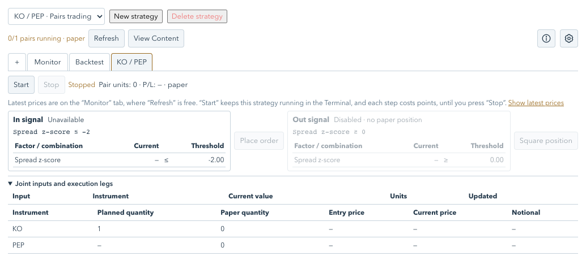

# Chapter 12. Paper monitoring and the final report

[繁體中文](../zh-TW/12-paper-monitoring-and-capstone.md) · [简体中文](../zh-CN/12-paper-monitoring-and-capstone.md) · English · [Edition contents](README.md)

A backtest looks backward at a frozen history. **Paper monitoring** lets you watch a rule run and keep a journal of its behavior. Use a separate stopped strategy for experiments if you already have paper positions you want to preserve.

### In Strategy Monitor

1. On **Monitor**, refresh the pair and verify that both price timestamps and symbols make sense. Choose a short observation session with a clear start and stop time. Review the point quote for the scheduled updates before you choose to proceed.
2. Open **KO / PEP** and click **Start** if you want to run the paper exercise. Note data status and signal readiness. Wait for valid inputs and a qualifying rule. If a signal never arrives, write “no signal” and end the observation. That is a useful result.
3. If available, **Place order** opens a paper ticket. Check both legs, prices and quantities before submitting. Use **Square position** to close a paper position while monitoring is running and prices are usable. **Stop** ends subsequent updates and preserves any open paper position. Verify the final status and quantities separately. When you only want to read the latest prices, use Refresh on Monitor.
4. Record the receipt or the reason execution was skipped. If a quote is stale, investigate the source and session. Record the event instead of using an old price to force a result.

*Figure 12-1. Start and Stop control monitoring. A paper position has its own quantity and closing action.*

### Capstone

Complete one [experiment journal](appendix.md). Include a pair hypothesis and rejection condition, a saved baseline, one formation result, one later holdout, and a record of your paper session. Report warm-up coverage, P&L with assumptions, and drawdown. List at least one reason the result could be misleading. Decide whether to continue research, revise and retest, or reject the pair. Give the evidence for your decision. A well-supported rejection completes the exercise.

### Exercise

You stop an observation and still see nonzero paper quantities. Did the position close? What do you write down?

Check your answer

The quantities show the position remains open. Record the stopped run, both quantities, whether the last prices were fresh, and when you intend to close or resume. Confirm a closing fill separately when you later square the position.

---

[Previous · Test a rule on unseen periods](11-test-unseen-periods.md) · [Edition contents](README.md) · [Next · Estimate the hedge ratio](13-estimate-the-hedge-ratio.md)
