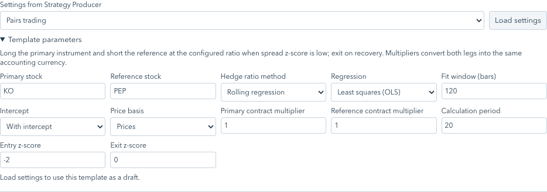

# Chapter 13. Estimate the hedge ratio

[繁體中文](../zh-TW/13-estimate-the-hedge-ratio.md) · [简体中文](../zh-CN/13-estimate-the-hedge-ratio.md) · English · [Edition contents](README.md)

A fixed weight is easy to reproduce. An estimate tries to fit the relationship **primary value ≈ intercept + ratio × reference value**. A fitted ratio depends on the order of the legs, the choice of prices or log prices, and the time span. Newer pairs templates offer the following methods.

| Method | When its ratio changes |
| --- | --- |
| Fixed ratio | It uses the number you enter until you change it. |
| Static fit | The report can show a fit from its own period. Trading uses the stored ratio. Copy a chosen fit into settings only for a later test. |
| Rolling regression | Refits each observation using the latest hedge window. OLS minimizes vertical errors in primary value; orthogonal (TLS) follows the principal axis of the pair in the chosen units. |
| Kalman filter | Starts from an initial fit and updates sequentially as observations arrive. The drift control changes how quickly the fitted relationship adapts. |

On a **price** basis a positive ratio can be interpreted as reference units per primary unit for multiplier-adjusted inputs. On a **log-price** basis the coefficient measures proportional sensitivity. The template maps it back to units using the two leg values at that observation. For example, log beta 1.2 at primary value 60 and reference value 150 corresponds to `1.2 × 60 ÷ 150 = 0.48` reference units per primary unit. A missing or nonpositive estimate can leave entry sizing unavailable.

### In Strategy Monitor

1. Start with the fixed baseline. Choose **Static fit**, keep your current stored ratio and run the formation period. Read the whole-period fitted ratio in the report if present. Record the estimate’s periods, basis and ticker order.
2. Load and apply the recorded estimate for a **later** period. Avoid applying the fit to the same dates that supplied it.
3. As a separate experiment, compare **Rolling regression** with the same sources and period. The **Fit window (bars)** fits the relation and the **calculation period** standardizes the spread. Record both. Increase the history if the combination leaves too few usable signals.
4. Try TLS or Kalman only after recording the first two runs. Change one method at a time and use Chapter 11 to assess the results.

*Figure 13-1. The hedge window and the z-score calculation period serve different purposes.*

### Exercise

You fit the ratio using all data through June, then use that saved ratio to simulate trades in March. What is the problem?

Check your answer

The March trade uses information from April through June. This is look-ahead bias. Test a static ratio only on observations after the formation period, or use a causal rolling model and respect the information available at each timestamp.

---

[Previous · Paper monitoring and the final report](12-paper-monitoring-and-capstone.md) · [Edition contents](README.md) · [Next · Assess whether the relationship holds](14-assess-the-relationship.md)
