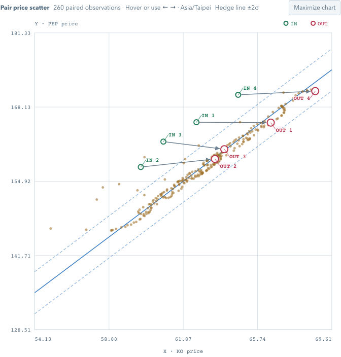

# Chapter 14. Assess whether the relationship holds

[繁體中文](../zh-TW/14-assess-the-relationship.md) · [简体中文](../zh-CN/14-assess-the-relationship.md) · English · [Edition contents](README.md)

A price scatter plot puts the two prices for each observation on one chart. Strategy Monitor uses primary price on the horizontal axis and reference price on the vertical axis. A narrow cloud can show a close fit. Read the fit tooltip to see which regression is drawn. A report fit or last-bar estimate describes its stated window, while each historical decision should use the estimate known at that observation.

*Figure 14-1. Inspect the orientation of the axes, the fit definition, and the marked trades. The pictured pair uses synthetic prices.*

| Diagnostic | Read it with this question |
| --- | --- |
| R² | How much of the variation in the fitted primary series does this relationship explain within the selected sample? Large R² can also come from shared trends. |
| Residual standard deviation | How large are deviations around the fitted relationship in the chosen units? |
| Half-life | How many observations does the fitted model estimate for a deviation to halve? An unavailable value can indicate no estimated reversion or insufficient data. |
| Cointegration p-value | How incompatible are these residuals with the test’s no-stationarity null under the model assumptions? A small value is evidence for the selected sample, with no guarantee of future behavior or trading profit. |

**Cointegration** asks whether a combination of individually nonstationary series can behave like a stationary series. Stationarity here means the spread’s statistical behavior is stable over time in the sense of the model. Strategy Monitor’s residual test is an Engle–Granger-style diagnostic. Reading many pairs and windows increases the chance of an apparently convincing result by chance. It is especially important to test your chosen rule on later data. [Engle and Granger](https://users.ssc.wisc.edu/~behansen/718/EngleGranger1987.pdf) · [MacKinnon](https://qed.econ.queensu.ca/working_papers/papers/qed_wp_0861.pdf)

### In Strategy Monitor

Compare the scatter, hedge fit and P&L of your formation report with your holdout report. In **Lines** inspect the hedge ratio or residual factors when present. Pick a conspicuous change in the fit or an unusually long losing trade and check its dates. Write down whether it coincides with a market or company event, a data issue, or a possibility you cannot resolve. Keep the evidence and your interpretation in separate sentences.

### Exercise

Formation R² is 0.95 and the cointegration p-value is 0.03. In the holdout the ratio moves sharply, half-life is unavailable, and the longest paper trade is still open at a loss. What should the report say?

Check your answer

The fit looked strong in formation. The later evidence failed to confirm that the same relationship and rule were stable. Record the specific disagreement, any data issues, and your decision to reject or investigate under a new, separately tested hypothesis.

---

[Previous · Estimate the hedge ratio](13-estimate-the-hedge-ratio.md) · [Edition contents](README.md) · [Next · Formulas, glossary, and experiment journal](appendix.md)
