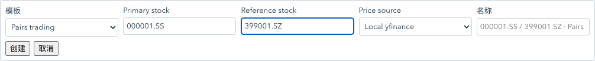
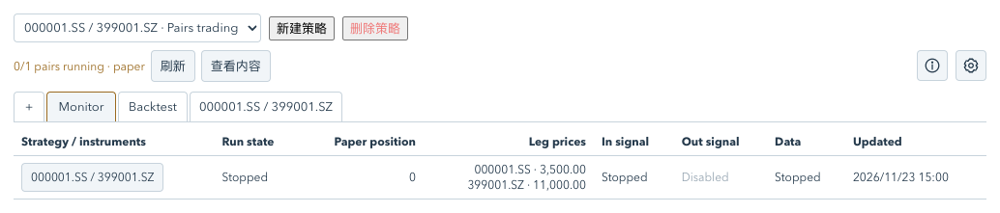
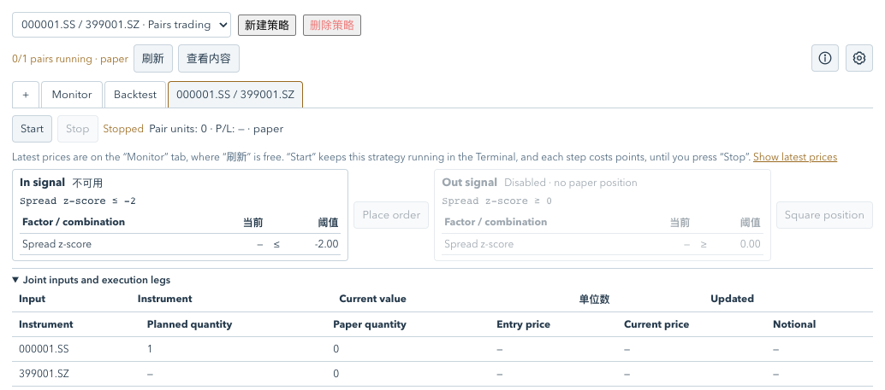

# 第 1 章　第一次观察两个股票指数

[繁體中文](../zh-TW/01-watch-your-first-pair.md) · 简体中文 · [English](../en/01-watch-your-first-pair.md) · [目录](../README.md)

如果上海和深圳的股票指数都上涨了，哪一个涨得更多？这一章用 Retis Terminal 的「策略监看」，带你建立上证指数和深证成指的观察配对，比较它们的点位与涨幅。约需 15 分钟，适合第一次接触股市的读者。

## 看懂指数代码和点位

一只股票代表一家公司的部分所有权。**股票指数**把一组股票的表现汇总成一个数字，用**点**来表示。点位可以用来比较同一个指数在不同时间的变化。观察配对时，两个指数各有自己的代码和起点。

| 指数 | Local yfinance 使用的代码 | 配对中的角色 |
| --- | --- | --- |
| 上证指数 | `000001.SS` | 主要标的 |
| 深证成指 | `399001.SZ` | 参考标的 |

可以在 Yahoo 财经核对[上证指数](https://finance.yahoo.com/quote/000001.SS/)和[深证成指](https://finance.yahoo.com/quote/399001.SZ/)的代码。请保留后缀，以免把代码输成其他标的。

先用虚构的点位练习。甲指数从 100 点涨到 110 点，涨幅是 10 ÷ 100 = **10%**。乙指数从 50 点涨到 52 点，涨幅是 2 ÷ 50 = **4%**。两个指数都上涨，甲的涨幅更大。比较涨跌幅时，要分别用各自的起始点位来算。

**配对交易**关注两个标的的相对变化，先定义如何衡量差距，再制定入场和离场规则。差距有时会缩小，有时会继续扩大。这两个指数是衡量市场表现的指标，无法直接买卖。本章用配对模板观察指数点位与相对变化，练习时让策略保持停止。

## 创建第一个指数配对

1. 登录桌面版 **Retis Terminal**，在新手入门工作区打开「策略监看」。也可以从侧栏的「新增数据浏览器」搜索。第一次登录可参考[首次使用说明（繁体中文）](../../../../docs/zh-TW/first-run.md)。
2. 点击 **新建策略**，选择 **Pairs trading（配对交易）**。在 **Primary stock** 输入 `000001.SS`，在 **Reference stock** 输入 `399001.SZ`。这两个字段沿用模板中的股票标签，本章在其中填入指数代码。
3. 在 **Price source** 选择 **Local yfinance**，点击 **创建**。简体中文界面中的一些控件保留英文，以图中的名称为准。

*图 1-1　创建前核对两个指数代码、后缀和数据源。*

> **如果找不到 Local yfinance**，从侧栏的「新增数据浏览器」打开「这台电脑」下的 Retis MAS Manager。安装本机 yfinance，等它运行后再回到策略监看。也可以用支持这两个指数历史数据的其他兼容来源。[本机 yfinance 安装说明（繁体中文）](../../../../docs/zh-TW/local-yfinance.md)

## 读懂监看总览

留在 **Monitor（监看）** 标签页，点击 **刷新**。找到 `000001.SS / 399001.SZ` 这一行，先读两个指数的点位，再看运行状态。创建策略和更新点位在策略监看中都不扣点。

*图 1-2　「Leg prices」栏在本例中显示指数点位。「Stopped」表示策略当前没有持续运行。日期和点位为示例数据。*

看到的点位是数据源最近能提供的值，休市后可能仍显示上一个交易时段的点位。看到「—」时，先确认代码、数据源与数据状态。「—」表示没有可显示的数值。暂时取不到数据时，可以用图 1-2 完成本章练习。

### 切换到单个配对标签页

点击 **000001.SS / 399001.SZ**。在配对标签页找到 **In signal（入场信号）** 和 **Out signal（离场信号）**。这里的**信号**表示策略条件是否成立。停止时你仍可看见规则，部分计算结果则会留空。查看后可以回到 **Monitor** 继续比较点位。

*图 1-3　配对标签页显示两项信号。表中的数量字段属于策略模板的模拟界面。*

| 标签页 | 用途 |
| --- | --- |
| Monitor（监看） | 查看配对、最新点位和运行状态。 |
| 单个配对 | 查看一个配对的信号和数据输入。 |
| Backtest（回测） | 用历史数据重放策略规则。后面会有一章专门练习。 |

## 练习　比较两个指数的涨幅

1. 抄下主要标的和参考标的的代码、点位，以及运行状态。如果用了图 1-2，请注明「示例数据」。
2. 从 Monitor 切到配对标签页，找出 **In signal** 和 **Out signal**，再回到 Monitor。说说两个标签页分别适合看什么。
3. 假设上证指数从 3500 点涨到 3570 点，深证成指从 11000 点涨到 11110 点。哪个上涨的点数更多？哪个涨幅更大？用「上涨点数 ÷ 原来的点位」计算涨幅。

查看参考答案

1. 图 1-2 的主要标的是上证指数 `000001.SS`，点位为 3500。参考标的是深证成指 `399001.SZ`，点位为 11000。策略处于停止状态。实际刷新看到的点位可能不同。
2. Monitor 适合查看最新点位和整体状态。单个配对标签页适合查看这一组配对的信号和数据输入。
3. 深证成指上涨 110 点，上证指数上涨 70 点。上证指数涨 70 ÷ 3500 = **2%**，深证成指涨 110 ÷ 11000 = **1%**。上证指数上涨的点数较少，涨幅更大。

下一章会用可交易标的举例，分别计算买入和做空两边的盈亏，再把结果加总。

*截图取自策略监看的简体中文界面，使用独立的示例数据。*
