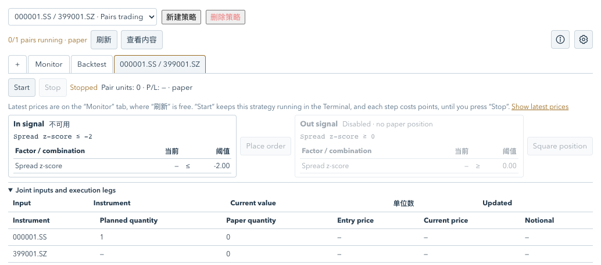

# 第 2 章　买入、做空与盈亏

[繁體中文](../zh-TW/02-long-short-and-profit.md) · 简体中文 · [English](../en/02-long-short-and-profit.md) · [本版目录](README.md)

一组配对交易有两边，界面也称为两条腿。**做多**是买入股票，之后卖出，股价上升时获利。**做空**是借入股票卖出，再买回归还，买回价低于卖出价时获利。实际做空还可能有借券费。股价继续上涨时，空头亏损也会增加。

下面用可交易的虚构股票解释算法。做多的股数记正数，做空的股数记负数。各边毛盈亏等于 **（离场价 − 入场价）× 带正负号的数量**。股票乘数取 1，把两边的毛盈亏加总，得到整笔的毛盈亏。

| 虚构标的 | 带正负号的股数 | 入场价 | 离场价 | 毛盈亏 |
| --- | ---: | ---: | ---: | ---: |
| 主要股票 | +1 | 100 元 | 108 元 | +8 元 |
| 参考股票 | −2 | 50 元 | 53 元 | −6 元 |
| 配对 | | | | **+2 元** |

两只股票都涨，做多一边赚 8 元，做空一边亏 6 元。如果参考股票涨到 58 元，做空一边会亏 16 元，整笔亏 8 元。入场时两边金额相近，也可能出现亏损。

### 在策略监看中观察

回到 **000001.SS / 399001.SZ** 标签页，找到 **Paper quantity（模拟数量）**、**In signal（入场信号）** 和 **Out signal（离场信号）**。保持停止。数字 0 表示目前没有模拟数量，信号则表示规则是否满足。上证指数和深证成指本身不能直接买卖。本版后续实验用指数点位研究规则，用虚构股票解释真实交易的算术。

*图 2-1　认识两边的数量列。指数点位和股票每股价格的含义不同。*

### 练习

用虚构股票做多 1 股，入场 100 元，做空 2 股，入场 50 元。离场价格分别为 97 元、46 元。两边的毛盈亏是多少？假设成本共 2 元，剩多少？

查看参考答案

多头亏 3 元，空头为 `（46 − 50）×（−2）= +8 元`。整笔毛盈亏为 +5 元，扣除假设成本后为 +3 元。

---

[上一章 · 第一次观察两个股票指数](01-watch-your-first-pair.md) · [本版目录](README.md) · [下一章 · 为什么把两个指数放在一起](03-why-trade-a-pair.md)
