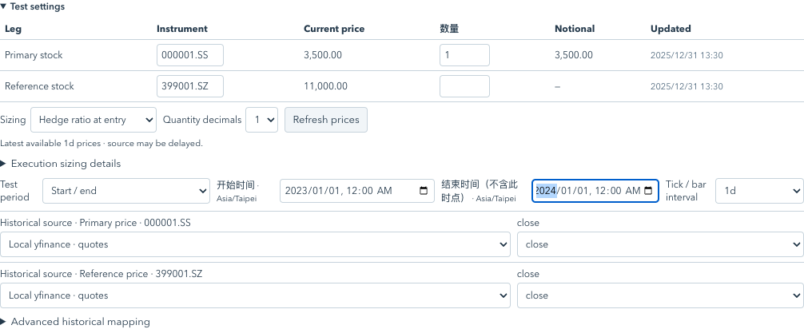

# 第 4 章　获取并核对指数数据

[繁體中文](../zh-TW/04-get-and-check-prices.md) · 简体中文 · [English](../en/04-get-and-check-prices.md) · [本版目录](README.md)

**Monitor** 显示来源最近可提供的观测。**Backtest** 使用历史来源和字段映射。映射告诉系统用哪一项作为点位、哪一项作为时间。监看时间和回放期间分别核对。

本版使用 **Local yfinance** 读取 `000001.SS` 和 `399001.SZ` 的历史指数点位。保留代码后缀，逐个检查来源是否有数据。无法访问时可以改用覆盖这两个指数的兼容历史来源，或先用本书的示例读图。[本机 yfinance 安装说明（繁体中文）](../../../../docs/zh-TW/local-yfinance.md)

| 检查项 | 怎样判断 |
| --- | --- |
| 收盘字段 | 对本章，日收盘字段应代表指数收盘点位。记录实际字段名和来源。 |
| 字段口径 | 用一致的点位口径。股票的复权收盘定义不能直接用来解释指数点位。 |
| 缺值 | 先查是否休市、代码是否完整、两边是否都在数据覆盖范围。缺值不能用 0 代替。 |
| 时间 | 同时检查观测日期和显示时区。两项都出现在同一行，也应检查时间是否可比。 |

### 在策略监看中操作

1. 在 **Monitor** 点击**刷新**，记录两边点位和 **Updated**。
2. 打开 **Backtest → Manual（手动）**，展开 **Test settings**。选择两边共同支持的日数据，检查历史来源和每边字段。来源使用的英语标签可能是 **Close** 或 `close`。
3. 把代码、来源、日周期、字段和时区抄入实验表。两条数据缺一条时先排查来源。检查是否取到了指数，而不是只输入六位代码后选到其他标的。

*图 4-1　逐边核对历史来源和字段。截图中的日期用于合成数据。*

### 练习

两边某一天突然出现很大差距。你发现参考指数那天缺一笔，能把其点位设成 0 吗？

查看参考答案

不能。查代码、来源、交易日及缺行原因。把该观测标为不可用。如果稍后采用其他对齐方法，需要记录所用规则，不能让后来的数据回填到过去。

---

[上一章 · 为什么把两个指数放在一起](03-why-trade-a-pair.md) · [本版目录](README.md) · [下一章 · 用加权价差衡量差距](05-build-a-weighted-spread.md)
