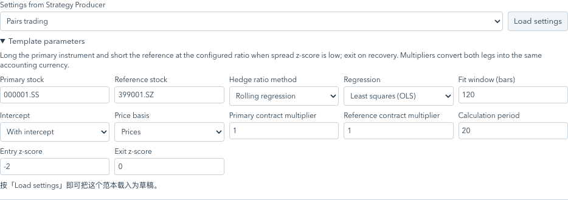

# 第 5 章　用加权价差衡量差距

[繁體中文](../zh-TW/05-build-a-weighted-spread.md) · 简体中文 · [English](../en/05-build-a-weighted-spread.md) · [本版目录](README.md)

两个指数的点位起点不同。**价差**是用指定权重算出的差距。本章选择价格基础和两个乘数 1：

> 价差 = 主要指数点位 − 信号对冲比率 × 参考指数点位

这里只把指数点位作为数值输入。算出的价差是加权后的模型刻度，没有直接的货币价值。若使用有合约乘数的交易标的，应先将各边价格乘上各自的乘数，再计算价差。

| 观测 | 主要数值 | 参考数值 | 比率 2 的价差 |
| --- | ---: | ---: | ---: |
| A | 100 | 50 | 0 |
| B | 96 | 49 | −2 |
| C | 108 | 53 | +2 |

从 B 到 C，价差增加 4。对虚构股票而言，恰好做多 1 股、做空 2 股，在不扣成本时有相同数值的毛盈亏。指数示例的这 4 是模型点位变化。换执行数量后，回放的盈亏也可能改变，信号价差仍可保持不变。

### 在策略监看中操作

1. 停止状态下点齿轮，选 **Pairs trading（配对交易）**，核对两指数顺序。
2. 选择 **Fixed ratio（固定比率）** 与 **Prices（价格）**。用第 1 章示例，`3500 ÷ 11000 ≈ 0.31818` 是教学起点。自己的试验使用测试前已经知道的一组点位，并记下时间和比率。指数模板乘数均为 1。
3. 点击 **Load settings** 加载草稿，再按 **Apply configuration** 保存。后面完成回放后，用 **Lines → Hedged spread** 查看某日价差，与手算对照。

*图 5-1　本章手算使用固定比率。图中所示的是可以调整的方法设置。*

### 练习

用精确的 `3500 ÷ 11000 = 7 ÷ 22`。第二天两个指数分别为 3570、11110。价差是多少？它是否自带入场信号？

查看参考答案

`3570 − (7 ÷ 22) × 11110 = 35`。这是加权价差，入场要进一步比较价差 Z 分数与门槛。

---

[上一章 · 获取并核对指数数据](04-get-and-check-prices.md) · [本版目录](README.md) · [下一章 · 用 Z 分数读价差](06-read-the-z-score.md)
