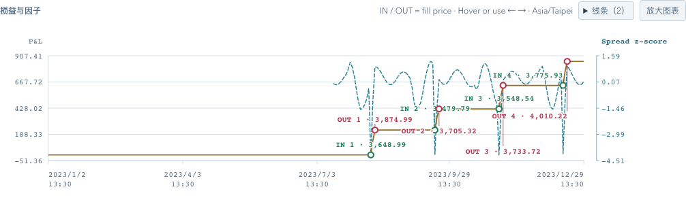

# 第 6 章　用 Z 分数读价差

[繁體中文](../zh-TW/06-read-the-z-score.md) · 简体中文 · [English](../en/06-read-the-z-score.md) · [本版目录](README.md)

不同配对的价差变化尺度不同。**Z 分数**把“离近期平均多远”换算成近期标准差的倍数：

> Z 分数 =（当前价差 − 滚动平均价差）÷ 滚动标准差

模板用最近 N 笔观测，包含当前一笔，并使用总体标准差。举例，四个价差是 `10、12、14、8`，平均为 11。平方差是 1、1、9、9，平均为 5，平方根约为 2.24。最后一个价差的 Z 分数是 `（8 − 11）÷ 2.24 ≈ −1.34`。

假设入场门槛是 −2，−1.34 还达不到。若模型已有部位，离场门槛为 0，则 −0.10 还不够，+0.10 达到条件。规则分别用 **≤** 和 **≥**。Z 分数还需要结合当前数据、样本和规则来解释。

### 在策略监看中操作

打开已完成的历史回放，操作见[第 8 章](08-run-a-manual-backtest.md)。在 **Lines** 选 **Spread z-score（价差 Z 分数）**，可再选 **Hedged spread（对冲价差）**。沿图移动十字线，读取同一天的两个数值。若样本没有积满、缺一项价格、或一段价差全相同，Z 分数会暂不可用。滚动估计还要先积累算对冲比率的数据。

*图 6-1　逐日对照 Z 分数和门槛。截图使用合成指数点位。*

### 练习

模型从空仓开始，Z 分数依次是 −1.8、−2.0、−2.4、−0.2、0.0。假设数据与数值都可用，入场 ≤ −2，离场 ≥ 0，模型会在哪两笔改变状态？

查看参考答案

−2.0 到达入场条件，0.0 到达离场条件。模型已持有部位时 −2.4 不会加开。缺失的 Z 分数本身无法触发入场。

---

[上一章 · 用加权价差衡量差距](05-build-a-weighted-spread.md) · [本版目录](README.md) · [下一章 · 建立并记录基准规则](07-build-a-baseline-strategy.md)
