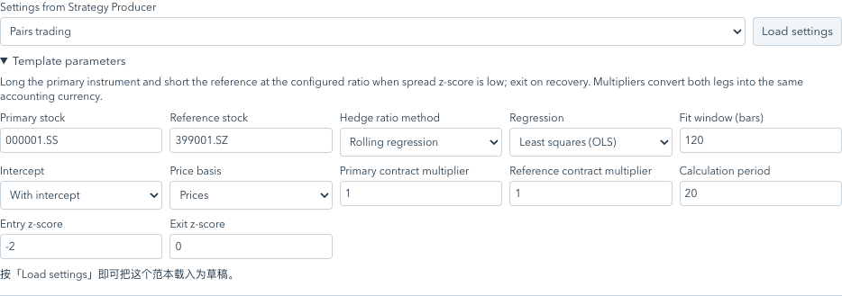

# 第 7 章　建立并记录基准规则

[繁體中文](../zh-TW/07-build-a-baseline-strategy.md) · 简体中文 · [English](../en/07-build-a-baseline-strategy.md) · [本版目录](README.md)

一条可重做的规则有四个部分：输入的两个标的、价差算法、开始和结束模拟部位的条件，以及回放数量。先记录规则，再看报告，以免把每次改动都算成事先决定。

| 设置 | 本章的练习基准 |
| --- | --- |
| 标的 | 主要 `000001.SS`，参考 `399001.SZ` |
| 数据 | 同一来源的日收盘点位 |
| 价差 | 价格基础、事前已知的固定比率、两个乘数均为 1 |
| 计算周期 | 20 笔观测 |
| 信号 | Z ≤ −2 入场，Z ≥ 0 离场 |
| 工作方式 | 观察与历史回放，保持策略停止 |

示例规则只判断一个方向。两个指数的角色一旦对调，价差含义就会变。题中的门槛也是实验设计的一部分。差距持续偏离时，模型可能很久都达不到离场条件。

### 在策略监看中操作

1. 策略停止时点齿轮进入 **Strategy settings**，先看保存的因子和 **In signal / Out signal**。
2. 选择 **Pairs trading**，重新填写要用的参数。模板初始值可能是默认值。点击 **Load settings** 后，核对两个代码、字段、对冲方法、周期和门槛。
3. 点击 **Apply configuration**，重新打开设置或**查看内容**核对保存值。给基准取一个易辨认的名称。以后改参数前，记下原参数并保存原结果。

*图 7-1　图中是默认的 Rolling regression。本章要选 Fixed ratio。核对草稿以后再按 Apply configuration 保存。*

### 练习

假如入场设为 −1.5，离场设为 −2，Z 分数 −1.8 会满足哪个条件？

查看参考答案

两个都满足。−1.8 小于 −1.5，同时大于 −2。模板要求入场门槛低于离场门槛，才能把偏离和回到目标范围区分开。

---

[上一章 · 用 Z 分数读价差](06-read-the-z-score.md) · [本版目录](README.md) · [下一章 · 第一次手动回放](08-run-a-manual-backtest.md)
