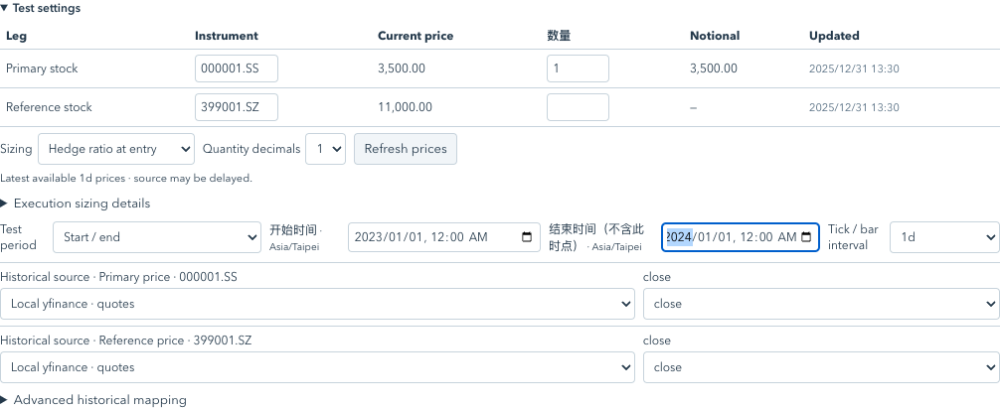

# 第 8 章　第一次手动回放

[繁體中文](../zh-TW/08-run-a-manual-backtest.md) · 简体中文 · [English](../en/08-run-a-manual-backtest.md) · [本版目录](README.md)

**回测**用过去的数据重放保存下来的规则。在指数版中，报告的 IN／OUT 标记代表模型在历史上的状态变化。报告可以帮助解释点位规律和模拟假设。指数本身无法直接成交，报告中的盈亏和数量属于模型。

### 在策略监看中操作

1. 打开 **Backtest → Manual** 和 **Test settings**。核对两个指数、日周期、历史来源和收盘字段。选取比暖机期长、来源有覆盖的日期范围。
2. 选 **Start / end**。开始时间包含在内，结束时间本身不包含。希望包含某日的观测时，把结束放在该观测之后。按笔数选择时，周末、休市和缺行会使笔数与日历日不同。
3. 选择数量政策。在 **Sizing** 选 **Fixed quantities**，主要标的输入 1，参考标的输入 0.32。两边使用正数，由模板决定方向。这些只是模型数量。查看点数报价之后点击 **Run backtest**。
4. 比较所选期间与报告的实际观测。记录观测数、暖机情况、关闭和仍开放的模型部位。查看一个信号对应的两边点位。若没有入场，记下原因。
5. 点击 **Save backtest**，再从已保存项目中打开。需要归档时用 **Download report**。请先保存，下一次运行可能取代未保存结果。

*图 8-1　图中是合成样本的设置，Sizing 仍显示初始选项。练习时改选 Fixed quantities，日期按来源覆盖调整。*

### 读懂成交假设

历史模拟可能直接使用产生信号的观测值去标记成交。实际按收盘信号执行的交易可以更晚，价格也会改变。指数点位还不等于某种可交易产品的成交价格。报表若有模型部位开放到最后，会按照最后可用值标记其未实现盈亏。

### 练习

Z 分数需要 20 笔，所选 20 个日历日只返回 14 笔日数据，报告显示零交易。先查什么？

查看参考答案

先确认是否一直在暖机，检查交易日、两个输入和缺值。延长为双方都有足够日数据的期间。若信号已就绪但从未到门槛，把它记为没有入场。

---

[上一章 · 建立并记录基准规则](07-build-a-baseline-strategy.md) · [本版目录](README.md) · [下一章 · 读懂回放报告](09-read-a-backtest-report.md)
