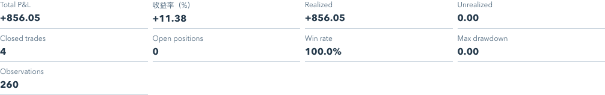

# 第 9 章　读懂回放报告

[繁體中文](../zh-TW/09-read-a-backtest-report.md) · 简体中文 · [English](../en/09-read-a-backtest-report.md) · [本版目录](README.md)

观察指数的报告，先看有多少有效观测和模拟交易，再看方向与变化。报表中的点位模型盈亏用来比较实验，无法当作某种指数产品的现金盈亏。

| 字段 | 怎样理解 |
| --- | --- |
| Realized P&L | 已结束的模型交易的盈亏。 |
| Unrealized P&L | 截至最后观测仍开放的部位的估计盈亏。 |
| Total P&L | 两项相加，按报告的成本模型处理。 |
| Win rate | 获利的已结束交易 ÷ 全部已结束交易，打平也算一笔。 |
| Max drawdown | 从先前的累计盈亏高点到之后低点的最大差额，起点为 0。 |
| Return | 看提示中的分母，不同报告的依据可能不同。 |

手动摘要可用峰值占用资本。若有保证金，受保证金约束的一边可能按配置的保证金计入，其余按入场价值计入。自动批次使用峰值同时持有的入场总名义金额。这两个指标用于模型比较，没有年化。指数示例的模拟单位不等于实际委托金额。

*图 9-1　先看覆盖与样本量。画面用合成点位计算。*

### 在策略监看中操作

打开保存的报告，找一对 **IN** 和 **OUT** 标记，核对时间、两个输入和模拟数量。沿累计盈亏图看持有期间是否有下降。若只有 IN，没有 OUT，区分总盈亏中还有多少未实现。也记录持有期间最长或最大回撤的一笔，避免只挑选盈利的例子。

### 练习

累计盈亏依次为 0、+20、+8、+25、+6，期末已实现 +10、未实现 −4。总盈亏和最大回撤是多少？若报表分母是 200，回报率是多少？

查看参考答案

总盈亏是 +6。最大回撤为 25 − 6 = 19。模型回报率按给定分母为 `6 ÷ 200 × 100 = 3%`。

---

[上一章 · 第一次手动回放](08-run-a-manual-backtest.md) · [本版目录](README.md) · [下一章 · 区分信号比率、数量和成本](10-position-sizing-and-costs.md)
