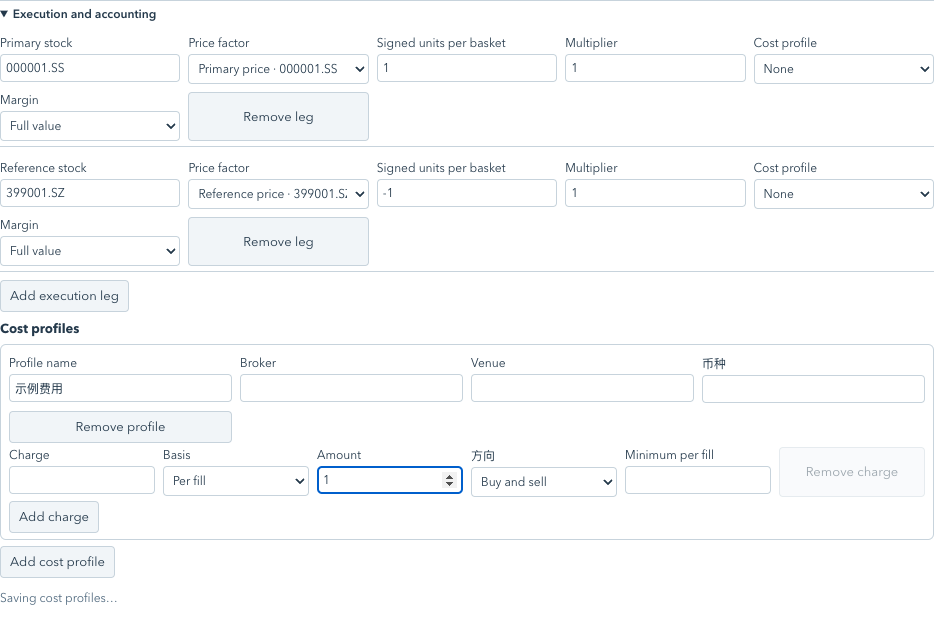

# 第 10 章　区分信号比率、数量和成本

[繁體中文](../zh-TW/10-position-sizing-and-costs.md) · 简体中文 · [English](../en/10-position-sizing-and-costs.md) · [本版目录](README.md)

**信号对冲比率**决定价差中两边的相对权重。**数量配置**决定回放里每边有多少模型单位。数量改变会影响模拟盈亏，信号本身可以保持原样。

| 配置方式 | 怎样计算 |
| --- | --- |
| Fixed quantities（固定数量） | 分别填两边数量。 |
| Balance at entry prices（按入场值平衡） | 按入场价格和乘数尽量平衡两边名义值，再按数量精度取整。 |
| Hedge ratio at entry（入场对冲比率） | 有此选项时，用入场观察的对冲单位数估算参考数量。 |

用虚构可交易股票说明。主要股价为 60 元，买 5 股名义金额 300 元。参考股价 150 元，做空 2 股名义金额也是 300 元。数量是 +5、−2，入场总名义金额是 600 元。实际交易还可能要付手续费、滑点及借券费，也受最小委托数量限制。指数配对只用模型单位理解这些区别。

### 在策略监看中操作

用同一组指数规则、日期和来源跑两次回放，只改变 **Sizing**。对比模型数量、入场名义值、盈亏。到齿轮下的 **Execution and accounting** 查看可用的成本配置，例如按边收费、滑点和资金项。算术比较时记录市场假设和成本模型。指数的名义值与费用字段仅描述该模拟模型，不能直接换算成实际经纪商费用。

*图 10-1　记录模型选择的数量和费用。实盘成本需要对应可交易标的和实际收费规则。*

### 练习

假设股票配对毛赚 12 元，四次成交每次 1 元，预计滑点共 3 元，借券费 2 元。剩多少？如果报告已经扣了 4 元手续费呢？

查看参考答案

估计净盈亏为 `12 − 4 − 3 − 2 = 3 元`。若手续费已扣，从 8 元起算，只扣还没计入的滑点和借券费。

---

[上一章 · 读懂回放报告](09-read-a-backtest-report.md) · [本版目录](README.md) · [下一章 · 用没看过的时期检验规则](11-test-unseen-periods.md)
