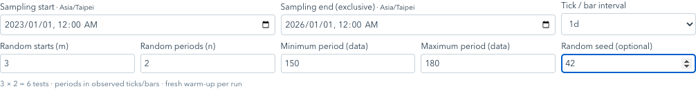
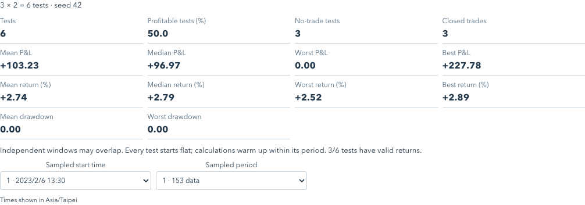

# 第 11 章　用没看过的时期检验规则

[繁體中文](../zh-TW/11-test-unseen-periods.md) · 简体中文 · [English](../en/11-test-unseen-periods.md) · [本版目录](README.md)

较早的**建模期**用来选择标的、权重和门槛。写下参数后，在较晚的**留出期**用同样规则。这能检验之前确定的规则能否适应后来数据。看完留出结果之后调参，就应把这段数据计入选择过程，再寻找新的未用过的样本。

### 在策略监看中操作

1. 为两个指数选两段互不重叠的时间。确认来源、字段和两段的暖机数据。先跑较早一段并保存。
2. 冻结参数和模拟数量。用 **Manual** 跑较晚一段，比较观测覆盖、信号次数、模拟盈亏和回撤。检查差异是否只由某一次指数大幅变化造成。
3. 切到 **Automatic** 研究时间窗敏感度。用 **m = 3、n = 2**，在数据量足够时设 150–180 笔日数据，种子 **42**。范围必须够长，让最长窗口完整落在所选区间。执行并保存这批历史回放。
4. 看盈利测试数、无交易窗口、中位数和最差回撤。用抽样开始时间、抽样周期或 **View test** 打开一个强结果和一个弱结果。记录差异。

*图 11-1　3 个起点与 2 种长度组合，共 6 个测试。每个窗口都从空仓开始重新暖机。*

*图 11-2　把窗口分开解释。图中数据为合成指数序列。*

时间窗可能重叠，结果不能当成一个投资组合的连续收益。记录种子、时间窗和数据快照，同一份数据和设置才能重现抽样。无入场窗口的盈亏按 0 计入，回报率不可用。

### 练习

六个窗口中两次正收益，两次负收益，两次无入场。盈利测试率是多少？六个互相重叠的窗口等于六份独立证据吗？

查看参考答案

盈利测试率为 `2 ÷ 6 ≈ 33.33%`，无入场也在分母中。窗口重叠会重复使用观测，不能将它们视为独立证据。

---

[上一章 · 区分信号比率、数量和成本](10-position-sizing-and-costs.md) · [本版目录](README.md) · [下一章 · 记录指数监看并完成报告](12-paper-monitoring-and-capstone.md)
