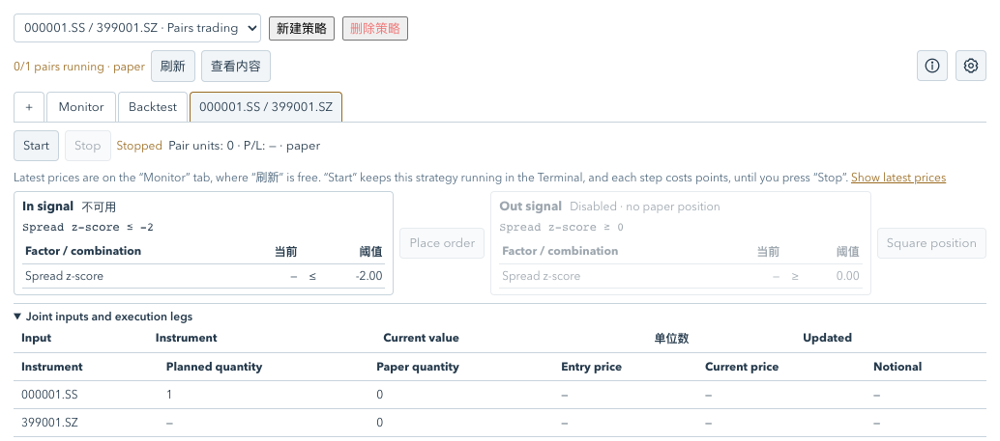

# 第 12 章　记录指数监看并完成报告

[繁體中文](../zh-TW/12-paper-monitoring-and-capstone.md) · 简体中文 · [English](../en/12-paper-monitoring-and-capstone.md) · [本版目录](README.md)

本版用指数点位做观察实验。回放是在历史上重放规则，监看则读取来源最新可用的观测。预先规定观测几次、记录哪些字段和什么时候结束。让指数策略保持停止。

### 在策略监看中操作

1. 在 **Monitor** 检查 `000001.SS / 399001.SZ` 和 **Stopped**。点击**刷新**，记录两个点位、数据时间、来源和本地读取时间。
2. 等下一个可比较的观测，例如下一个完整交易日，再刷新。用第 5 章同一个比率算价差，记录它向哪个方向变动。只有一边有新数据时，等两边能对齐再比较。
3. 打开配对页辨认 **Start / Stop** 和 **In signal / Out signal**。停止时可能没有实时因子值，可从已保存的回放看历史信号。对可交易标的，**Stop** 是结束持续更新，已经存在的模拟部位仍需单独核对结束数量。本版的指数观察不用模拟下单。
4. 把数据过期、无新数据或没有符合条件的信号写入日志。不必为了让报告有交易而改变门槛。

*图 12-1　本版只观察指数。用 Monitor 刷新最新点位，用历史报告查看规则。*

### 期末实作

填一份[实验记录表](appendix.md)。写明为什么比较这两个指数、何时会放弃假设、基准规则、较早和较晚的回放，以及至少两次观测或取数失败的记录。比较预先写下的判断与实际数据，说明样本覆盖和缺值。结尾选择「继续研究」「修改后另测」或「放弃假设」，引用至少一条结果作为证据。

### 练习

周末连续刷新两次，看到同样的点位与同样的观测时间。能够当成两笔新观测吗？

查看参考答案

不能。记录一次已有观测及两次刷新时间，等两边都有时间可核对的新观测再比较。刷新是重新读取，观察时间不必随刷新时间更新。

---

[上一章 · 用没看过的时期检验规则](11-test-unseen-periods.md) · [本版目录](README.md) · [下一章 · 估计信号对冲比率](13-estimate-the-hedge-ratio.md)
