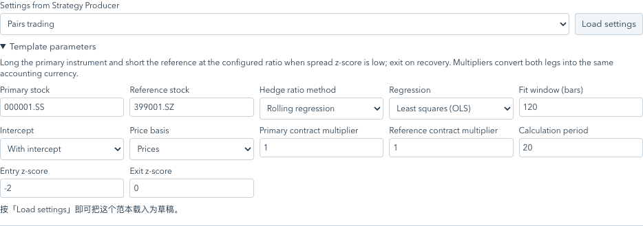

# 第 13 章　估计信号对冲比率

[繁體中文](../zh-TW/13-estimate-the-hedge-ratio.md) · 简体中文 · [English](../en/13-estimate-the-hedge-ratio.md) · [本版目录](README.md)

固定比率容易复核。拟合方法尝试估计 **主要数值 ≈ 截距 + 比率 × 参考数值**。结果依赖标的顺序、所选时间与价格或对数基础。这里的指数对冲比率用于衡量相对变化。

| 方法 | 比率如何确定 |
| --- | --- |
| Fixed ratio | 使用填写的固定比率。 |
| Static fit | 报告可显示本期的全期拟合值，规则采用已保存的比率。可以把拟合值保存给较晚的样本。 |
| Rolling regression | 每笔按最近估计窗口重新拟合。OLS 最小化主要数值方向的平方误差，TLS 沿所用单位下点云主方向拟合。 |
| Kalman filter | 从一段初始数据估计，再随新观测逐步调整。漂移控制影响响应速度。 |

价格基础的正比率可用于把参考单位换算到每个主要单位。对数基础的系数表示比例变化的灵敏度。模板会按当时两边的价值，将它换算成参考单位。例如对数系数 1.2，主要值 60，参考值 150，换算为 `1.2 × 60 ÷ 150 = 0.48`。非正或暂不可用的比率可能让入场数量计算无法完成。

### 在策略监看中操作

1. 保存固定比率作为对照。改用 **Static fit**，用已保存的比例跑较早区间，读取可用的全期拟合值。记下顺序、基础和日期。
2. 将拟合出来的值保存到设置，使用较晚的窗口检验。用全期比率回测同一时间范围内较早的日期会提前借用信息。
3. 另作 **Rolling regression** 实验。保持相同数据和期间，分别记录 **Fit window (bars)** 和 **Calculation period**。前者用于拟合关系，后者用于计算价差 Z 分数。
4. 准备充足观测后，可分别试一次 TLS 或卡尔曼。改变方法时不要同时改门槛，再按第 11 章评估较晚数据。

*图 13-1　估计窗口和 Z 分数周期的用途不同。*

### 练习

使用一到六月估计的比率回测三月信号，有什么问题？

查看参考答案

三月信号用了四到六月才产生的信息，属于前视偏差。用六月之后的数据测试静态系数，或选择在每笔仅用当时数据的滚动估计。

---

[上一章 · 记录指数监看并完成报告](12-paper-monitoring-and-capstone.md) · [本版目录](README.md) · [下一章 · 检验指数关系是否稳定](14-assess-the-relationship.md)
