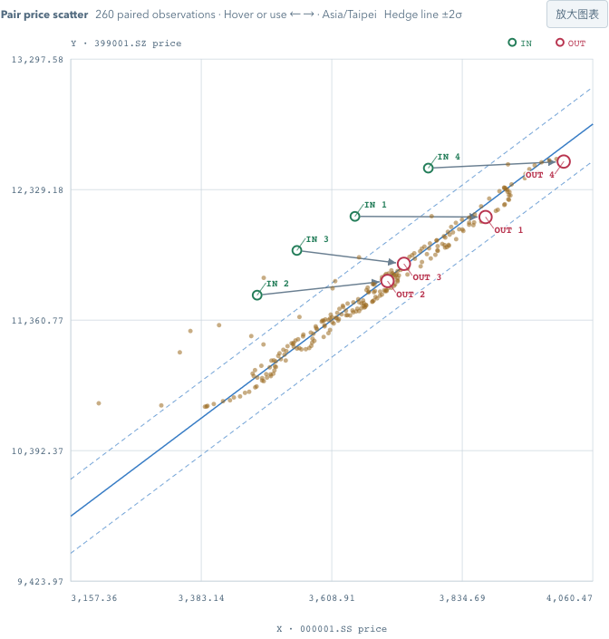

# 第 14 章　检验指数关系是否稳定

[繁體中文](../zh-TW/14-assess-the-relationship.md) · 简体中文 · [English](../en/14-assess-the-relationship.md) · [本版目录](README.md)

价格散点图的横轴是主要标的，纵轴是参考标的。在本版两轴都用指数点位。每个点对应一笔配对观测。点云集中也可能只是共同趋势，要读图中的拟合提示，核对方法、期间和最新一笔估计。回放中的信号只应依赖当时能知道的信息。

*图 14-1　检查轴的方向、拟合方法和 IN／OUT 标记。它们用于解释模拟过程。*

| 诊断 | 应该怎样读 |
| --- | --- |
| R² | 拟合对样本中主要序列的变动解释了多少？共同趋势也可能给出较高的值。 |
| 残差标准差 | 偏离拟合关系时通常相差多少？单位取决于拟合基础。 |
| 半衰期 | 模型估计偏离缩小一半需要多少笔？不可用可能表示数据不足或看不出回归。 |
| 协整 p 值 | 给定模型假设，残差非平稳的原假设与样本有多不相容？小值只提供所选样本中的证据。 |

**协整**考虑的是两个各自非平稳的序列是否存在一个具有平稳统计行为的组合。平稳可以先理解为：在模型下，组合的变动特性随时间比较稳定。策略监看提供 Engle–Granger 类型的残差检验。反复尝试很多个指数或时间窗口，容易偶然得到看似有力的统计量。需要用后来的数据检查预先写好的规则。[Engle 与 Granger](https://users.ssc.wisc.edu/~behansen/718/EngleGranger1987.pdf) · [MacKinnon](https://qed.econ.queensu.ca/working_papers/papers/qed_wp_0861.pdf)

### 在策略监看中操作

将建模期与留出期的散点、估计比率和模拟历史并排。通过 **Lines** 看可用的比率和残差相关输出。找一次比率明显变化的日期或长时间未结束的模拟部位，核对是否可能涉及指数成分调整、市场变化或数据问题。写下观察到的现象，再写可能解释。

### 练习

建模期 R² 是 0.95，协整 p 值是 0.03。留出期比率明显变动、半衰期不可用，而模型差距也持续扩大。下一步怎样写？

查看参考答案

写明较早样本拟合看起来不错，但后来的结果未确认规则稳定。记录具体日期、比率变化与可能的数据问题，再决定放弃假设或提出一个需另外检验的新假设。

---

[上一章 · 估计信号对冲比率](13-estimate-the-hedge-ratio.md) · [本版目录](README.md) · [下一章 · 公式、词汇与实验记录](appendix.md)
