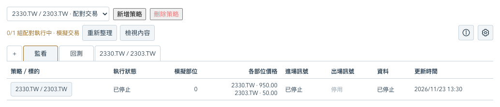
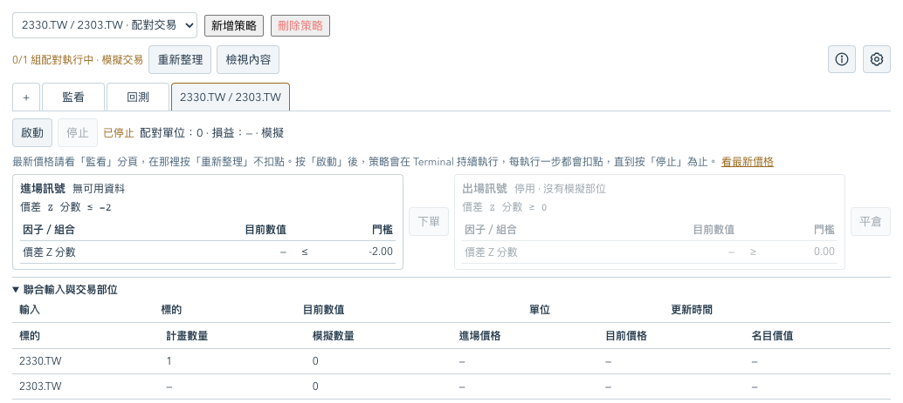

# 第 1 章　第一次觀察兩檔股票

繁體中文 · [简体中文](../zh-CN/01-watch-your-first-pair.md) · [English](../en/01-watch-your-first-pair.md) · [目錄](../README.md)

兩檔股票今天都上漲，漲得一樣多嗎？這一章用 Retis Terminal 的「策略監看」，帶你比較台積電與聯電，建立第一個配對範例，並找出畫面上的價格與訊號。約需 15 分鐘，適合第一次接觸股票的讀者。

## 先看懂股票代碼與價格

股票代表公司的一小部分所有權。每股價格會隨市場交易變動。**股票代碼**是你在軟體裡查找股票時用的識別名稱。本書沿用策略監看畫面上的寫法。

| 公司 | 畫面上的代碼 | 範例裡的角色 |
| --- | --- | --- |
| 台積電 | `2330.TW` | 主要股票 |
| 聯電 | `2303.TW` | 參考股票 |

先用虛構的價格練習。甲股票從 100 元漲到 110 元，漲幅是 10 ÷ 100 = **10%**。乙股票從 50 元漲到 52 元，漲幅是 2 ÷ 50 = **4%**。兩檔都上漲，甲的漲幅較大。比較漲跌幅時，要用各自的起始價格來算。

**配對交易**觀察兩檔股票的相對變化。策略先定義如何衡量兩檔之間的差距，再用規則決定何時進場或出場。本書的範例進場時會買進一檔、放空另一檔。放空可以先理解成先借股票賣出，之後再買回歸還。差距可能收回，也可能繼續擴大，所以光知道兩檔都上漲，還無法判斷整筆交易的結果。

## 建立第一個配對範例

本章的台股範例推薦用 **富果（Fugle）行情 API** 取得價格。先準備自己的富果金鑰。可從[富果行情 API 方案](https://developer.fugle.tw/docs/pricing/?utm_source=attas&utm_medium=docs&utm_campaign=attas_pricing&utm_content=strategy_monitor_zh)（合作推廣連結）查看方案與申請方式。

1. 登入桌面版 **Retis Terminal**。在「新手入門」工作區開啟「策略監看」，通常就在「台灣半導體觀察」旁邊。也可以從側邊欄的 **新增資料瀏覽器** 搜尋「策略監看」。第一次登入可參考[第一次使用](../../../../docs/zh-TW/first-run.md)。
2. 到 **終端設定 → 資料來源**，展開 **FugleDataSource**，將自己的富果金鑰填入 **API 金鑰**，再按 **儲存來源設定**。金鑰保存在你的 Terminal，只會直接送到富果。
3. 回到策略監看，按 **新增策略**。在 **範本** 選「配對交易」，輸入主要股票 `2330.TW` 與參考股票 `2303.TW`，在 **價格來源** 選 **FugleDataSource**，按 **建立**。

*圖 1-1　建立前確認兩檔代碼正確，並確認「價格來源」顯示 FugleDataSource。*

> **若清單沒有 FugleDataSource**，先回「終端設定 → 資料來源」確認金鑰已儲存，再重新開啟「新增策略」。尚未申請富果金鑰時，也可用[本機 yfinance](../../../../docs/zh-TW/local-yfinance.md)練習，或直接閱讀圖 1-2 的示範資料。

## 讀懂監看總覽

留在 **監看** 分頁，按 **重新整理**。找到 `2330.TW / 2303.TW` 這一列，先讀兩檔股票的價格，再看執行狀態。建立範例與更新價格都不扣點。策略監看使用模擬交易，本章只需觀察畫面。

*圖 1-2　「各部位價格」欄列出兩檔股票的價格。「已停止」表示策略目前沒有持續執行。日期與價格為示範資料。*

價格是資料來源最近能提供的值。休市後可能仍看到上一個交易時段的價格。看到「—」時，先檢查價格來源與資料狀態。「—」表示這一格沒有可顯示的數值，請把它和數字 0 分開記錄。

### 切到個別配對分頁

按 **2330.TW / 2303.TW** 分頁。這裡可以查看這一組配對的模擬部位、進出場訊號與資料輸入。**部位**是目前持有的數量，**訊號**則告訴你策略條件是否成立。找到這些欄位後，讓新建範例保持停止。

*圖 1-3　個別配對分頁顯示模擬部位與進出場訊號。策略尚未啟動時，部分欄位會留白或顯示「—」。*

| 分頁 | 用途 |
| --- | --- |
| 監看 | 查看所有配對、價格與狀態。 |
| 個別配對 | 查看一組配對的部位、訊號與資料輸入。 |
| 回測 | 用過去的價格模擬策略。後面會有一章專門練習。 |

## 練習　讀出你看到的資訊

1. 抄下主要股票與參考股票的代碼、兩檔價格，以及執行狀態。如果取不到價格，就用圖 1-2 練習，並註記「示範資料」。
2. 從「監看」切到配對分頁，找出「進場訊號」與「出場訊號」，再回到「監看」。說出兩個分頁各適合看什麼。
3. 如果圖 1-2 的價格分別從 950 元漲到 960 元、50 元漲到 51 元，哪一檔漲幅較大？試著用「價格增加多少 ÷ 原本價格」計算。

查看參考答案

1. 圖 1-2 的主要股票是台積電 `2330.TW`，價格 950 元。參考股票是聯電 `2303.TW`，價格 50 元。策略是「已停止」。你重新整理後看到的價格可能不同。
2. 「監看」適合看整體狀態。個別配對分頁適合查看一組配對的部位、訊號與資料輸入。
3. 台積電漲 10 ÷ 950，約 **1.05%**。聯電漲 1 ÷ 50，等於 **2%**。聯電漲的金額較小，漲幅卻較大。

下一章會用一張簡單的交易表，算出買進與放空兩邊各賺賠多少，再把兩邊合起來看。

*截圖擷取自策略監看的繁體中文介面，使用獨立的示範資料。*

---

[本版目錄](README.md) · [下一章 · 買進、放空與損益](02-long-short-and-profit.md)
