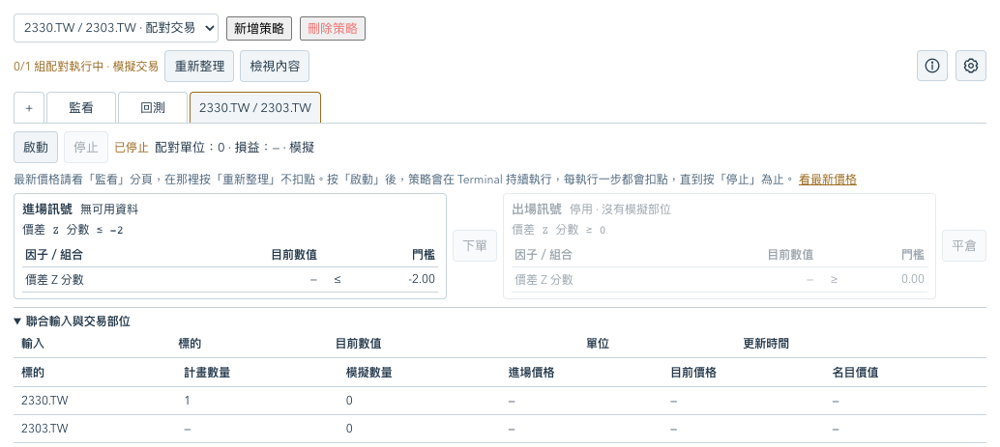

# 第 2 章　買進、放空與損益

繁體中文 · [简体中文](../zh-CN/02-long-short-and-profit.md) · [English](../en/02-long-short-and-profit.md) · [本版目錄](README.md)

配對交易有兩邊，交易畫面也稱為兩「腿」。**做多**是買進股票，之後賣出。價格上升時，做多的一邊獲利。**放空**是先借股票賣出，之後買回歸還。買回價低於原先賣價時，放空的一邊獲利。實際放空可能有借券費。股價持續上漲時，放空的虧損也會增加。

把做多的股數寫成正數，放空的股數寫成負數。每邊毛損益是 **（出場價 − 進場價）× 帶正負號的數量**。本章的股票合約乘數為 1。將兩邊相加，就得到整筆交易未扣成本的損益。

| 虛構標的 | 帶正負號的股數 | 進場價 | 出場價 | 毛損益 |
| --- | ---: | ---: | ---: | ---: |
| 主要股票 | +1 | 100 元 | 108 元 | +8 元 |
| 參考股票 | −2 | 50 元 | 53 元 | −6 元 |
| 配對 | | | | **+2 元** |

兩檔都上漲，做多的一邊賺 8 元，放空的一邊虧 6 元。若參考股票改漲到 58 元，放空一邊將虧 16 元，整筆交易虧 8 元。即使進場時兩邊金額接近，配對仍可能虧損。

### 在策略監看操作

在第 1 章的策略開啟 **2330.TW / 2303.TW** 分頁，找到兩檔股票的**模擬數量**和**進場訊號／出場訊號**，讓策略維持停止。數量為 0 表示沒有部位。訊號表示條件是否成立。要核算交易損益，還需要成交紀錄上的兩邊價格和數量。

*圖 2-1　先辨認兩個標的，並分清數量 0 和表示價格尚未取得的「—」。*

### 練習

做多 1 股，進場價 100 元。另放空 2 股，進場價 50 元。出場時兩檔分別為 97 元與 46 元。算出兩邊及整筆的毛損益。若總成本為 2 元，還剩多少？

查看參考答案

做多虧 3 元，放空為 `（46 − 50）×（−2）= +8 元`。毛損益為 +5 元，扣假設成本後為 +3 元。

---

[上一章 · 第一次觀察兩檔股票](01-watch-your-first-pair.md) · [本版目錄](README.md) · [下一章 · 為什麼把兩檔組成一對](03-why-trade-a-pair.md)
