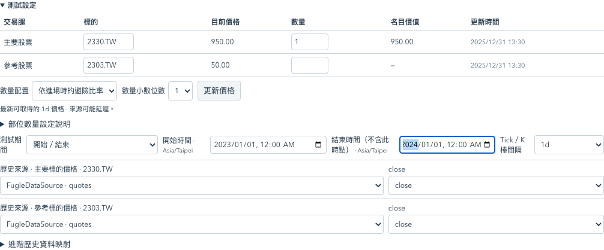

# 第 4 章　取得並核對兩邊價格

繁體中文 · [简体中文](../zh-CN/04-get-and-check-prices.md) · [English](../en/04-get-and-check-prices.md) · [本版目錄](README.md)

策略監看要能取得兩檔資料。**監看**頁顯示來源最近能提供的觀測值。**回測**另外有歷史來源與欄位對應，告訴系統哪個欄位是價格、哪個是時間。兩處的用途不同，做實驗時要分別核對。

本版使用富果取得台積電／聯電價格。若市場來源有變，先確認兩個標的都能取得同一種日資料。富果使用自己的金鑰，設定方式見第 1 章。[富果行情 API 方案](https://developer.fugle.tw/docs/pricing/?utm_source=attas&utm_medium=docs&utm_campaign=attas_pricing&utm_content=strategy_monitor_zh)（合作推廣連結）

| 看到的欄位或狀況 | 要檢查什麼 |
| --- | --- |
| 收盤價 | 確認是所選日期及時段的收盤價。 |
| 還原收盤價 | 依來源方法調整除權息或分割等事件。兩邊用一致口徑，並記下實際欄位。 |
| 缺少一筆資料 | 核對代碼、交易日與來源範圍，避免把缺值填成 0。 |
| 資料時間 | 看觀測日期與顯示時區。休市後重新整理仍可能顯示上一個交易時段。 |

### 在策略監看操作

1. 在**監看**按**重新整理**，記下兩檔價格與「更新時間」。若時間不同，先查明原因。
2. 開啟**回測 → 手動**，展開測試設定。找出兩邊的歷史來源、週期與價格欄位。先選雙方都支援的日資料。
3. 把來源、欄位、日資料與時區寫進實驗筆記。新增來源或換欄位後，就再核對一次。若一邊還原、另一邊未還原，先改成一致口徑再解讀價差。

*圖 4-1　選好兩檔之後，逐邊核對歷史來源與價格對應。*

### 練習

其中一檔分割的當天，價差突然跳動。你會怎麼檢查？若另一個交易日只有一檔有資料呢？

查看參考答案

核對兩邊的收盤價和還原規則，先用一致口徑重做相同測試。若缺少一檔資料，檢查代碼、交易日和來源覆蓋，將該日記成不可用。沒有明確理由時不要補 0，也不要把較晚的價格填回前一天。

---

[上一章 · 為什麼把兩檔組成一對](03-why-trade-a-pair.md) · [本版目錄](README.md) · [下一章 · 用加權價差衡量差距](05-build-a-weighted-spread.md)
