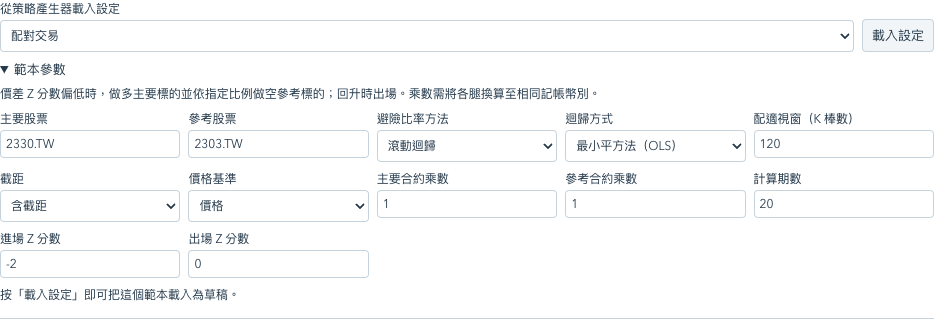

# 第 5 章　用加權價差衡量差距

繁體中文 · [简体中文](../zh-CN/05-build-a-weighted-spread.md) · [English](../en/05-build-a-weighted-spread.md) · [本版目錄](README.md)

**價差**把兩邊的相對價格濃縮成一個數字。本章先用固定比率與兩個乘數 1：

> 價差 = 主要股票價格 − 訊號避險比率 × 參考股票價格

若使用有合約乘數的標的，先把各邊價格乘上各自的乘數，再按公式計算。「訊號避險比率」是計算價差用的相對權重。

| 觀測 | 主要價格 | 參考價格 | 比率 2 的價差 |
| --- | ---: | ---: | ---: |
| A | 100 | 50 | 0 |
| B | 96 | 49 | −2 |
| C | 108 | 53 | +2 |

B 到 C 的價差上升 4。若恰好做多 1 股、放空 2 股，且忽略成本，這兩筆觀測間的毛損益也是 4。換用不同成交數量後，損益會變化，即使訊號價差維持原樣。

### 在策略監看操作

1. 在停止狀態按齒輪，從**從策略產生器載入設定**選**配對交易**，核對兩檔代碼。
2. 選**固定比率**、以價格為基礎，兩檔乘數保留 1。可用測試期間之前的一組已知價格估算簡單起點。例如用第 1 章的示範價格算 `950 ÷ 50 = 19`。實際操作要記下選比率的日期和價格。
3. 按**載入設定**，確認草稿後按**套用設定**。完成後續回測時，在**線條**勾選**避險價差**，挑一天核對自己算出的結果。

*圖 5-1　畫面示範範本參數的位置。本章手算練習請把方法改選固定比率。*

### 練習

比率為 19，某日台積電為 960 元、聯電為 51 元。當日價差多少？價差為負時一定會進場嗎？

查看參考答案

`960 − 19 × 51 = −9`。範本是比較價差 Z 分數與進場門檻。只知道價差為負，還不能判斷訊號。

---

[上一章 · 取得並核對兩邊價格](04-get-and-check-prices.md) · [本版目錄](README.md) · [下一章 · 用 Z 分數讀懂價差](06-read-the-z-score.md)
