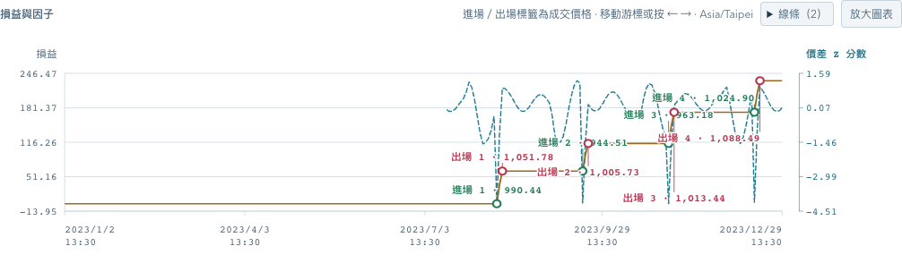

# 第 6 章　用 Z 分數讀懂價差

繁體中文 · [简体中文](../zh-CN/06-read-the-z-score.md) · [English](../en/06-read-the-z-score.md) · [本版目錄](README.md)

價差 −2 對某組配對可能很大，對另一組卻很小。**Z 分數**用近期價差自身的變動幅度，衡量目前價差偏離平均多少：

> Z 分數 =（目前價差 − 近期平均價差）÷ 近期標準差

策略的計算期數是最近 N 筆觀測，包含當前一筆，範本使用母體標準差。例如四筆價差是 `10、12、14、8`，平均為 11。平方差為 1、1、9、9，平均為 5，開根號得到約 2.24。最後一筆的 Z 分數約為 `（8 − 11）÷ 2.24 = −1.34`。

進場門檻設為 −2 時，−1.34 尚未達到條件。若已有部位且出場門檻是 0，−0.10 還不夠，+0.10 則達到門檻。範本用 **≤** 判斷進場，用 **≥** 判斷出場。Z 分數表示相對於近期樣本的位置。

### 在策略監看操作

打開一份已完成的回測（步驟見[第 8 章](08-run-a-manual-backtest.md)）。在**線條**勾選**價差 Z 分數**，也可同時勾選**避險價差**。沿圖移動十字線，查同一天的兩個數值。注意最初還在暖機的部分，缺值和整段價差沒有變動也可能使 Z 分數無法計算。選用滾動估計時，先要有足夠資料算避險比率，再累積計算 Z 分數的價差。

*圖 6-1　移動十字線查看觀測時間與 Z 分數。圖中為合成資料。*

### 練習

策略無部位，之後有 −1.8、−2.0、−2.4、−0.2、0.0 五筆 Z 分數。假設兩邊價格與數量都可用，規則為進場 ≤ −2、出場 ≥ 0。在哪兩筆進出場？

查看參考答案

−2.0 進場，0.0 出場。在持有期間，−2.4 不會多開一筆。若 −2.0 當筆缺少有效訊號，便不能由這一筆觸發進場。

---

[上一章 · 用加權價差衡量差距](05-build-a-weighted-spread.md) · [本版目錄](README.md) · [下一章 · 建立並記下基準規則](07-build-a-baseline-strategy.md)
