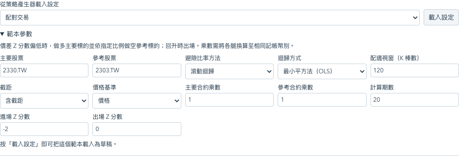

# 第 7 章　建立並記下基準規則

繁體中文 · [简体中文](../zh-CN/07-build-a-baseline-strategy.md) · [English](../en/07-build-a-baseline-strategy.md) · [本版目錄](README.md)

一條可重做的規則要說清楚四件事：用哪兩檔、怎麼算價差、何時進出場，以及用什麼方式決定數量。先把這些寫進筆記，之後才容易比較哪個改動造成結果不同。

| 設定 | 本書的練習基準 |
| --- | --- |
| 標的 | 主要 `2330.TW`，參考 `2303.TW` |
| 資料 | 富果日資料，兩邊用一致的價格口徑 |
| 價差 | 價格基礎，固定比率，兩邊乘數為 1 |
| 計算期數 | 20 筆觀測 |
| 進出場 | Z ≤ −2 進場，Z ≥ 0 出場 |
| 方向 | 進場買主要、放空參考 |

範本對應一個方向。把交易方向改為反向會改變兩邊買賣，原本的進出場比較條件仍在。這組門檻是教學基準，價差如果持續偏離，可能長時間沒有符合出場條件。

### 在策略監看操作

1. 在策略停止時開啟齒輪**策略設定**，先看已儲存的計算項目與進出場條件。
2. 從範本選**配對交易**，重新填入基準參數。範本欄位可能帶入預設值，逐項核對你要保留的設定。按**載入設定**後檢查草稿的兩個標的、來源、避險方法及門檻。
3. 按**套用設定**，用**檢視內容**或重開設定核對結果。可在名稱加上「基準」，另做一份實驗筆記。日後改參數時，先寫下原本的值，並另存原回測。

*圖 7-1　畫面顯示預設的滾動迴歸。本章請切換固定比率，載入草稿並核對後再套用。*

### 練習

若進場門檻設為 −1.5，出場門檻設為 −2，Z 分數 −1.8 會符合哪一項？

查看參考答案

兩項都符合。−1.8 小於 −1.5，同時大於 −2。範本要求進場門檻小於出場門檻，讓偏離與回復使用不同的區間。

---

[上一章 · 用 Z 分數讀懂價差](06-read-the-z-score.md) · [本版目錄](README.md) · [下一章 · 跑第一次手動回測](08-run-a-manual-backtest.md)
