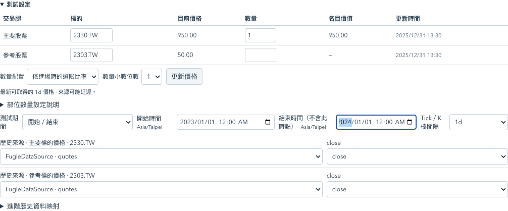

# 第 8 章　跑第一次手動回測

繁體中文 · [简体中文](../zh-CN/08-run-a-manual-backtest.md) · [English](../en/08-run-a-manual-backtest.md) · [本版目錄](README.md)

**回測**是在過去的觀測資料上重放已儲存規則，查看模擬器會在哪些時間進出場。先完成第 7 章的設定，再第一次重放。保留原規則，之後才有基準可比。

### 在策略監看操作

1. 開啟**回測 → 手動**，展開測試設定。核對兩個標的、資料來源、價格欄位和日資料。挑資料商涵蓋、而且長於暖機所需的期間，例如有幾個月的日資料。
2. 選「開始／結束」。開始包含在期間內，結束時間不包含。要包含最後一個交易時段，就把結束放在該觀測之後。改用資料筆數時，計算的是觀測，不是日曆天數。
3. 選定一種配對數量配置。第一輪選**固定數量**，主要填 1 股，參考填 19 股。兩欄都填正數，由範本決定方向。確認操作的點數報價，再按**執行回測**。
4. 比對要求期間和實際觀測期間。讀取資料筆數、暖機、已平倉交易、未平倉部位。若有進場，記下第一筆的時間與兩邊價格。若沒有，記下畫面提示。
5. 按**儲存回測**並從已儲存清單重新開啟。需要留存時用**下載報告**。下一次回測可能取代尚未儲存的結果。

*圖 8-1　圖中以合成資料示範設定，配置仍顯示初始選項。練習時改選固定數量，並按自己的資料覆蓋調整期間。*

### 先看回測的假設

模擬器可以用同一筆觀測價格做成交。若現實中要等看到收盤價才決定，實際成交可能更晚且價格不同。把這件事寫進紀錄，之後再用成本或不利成交假設做對照。回測結束時，未平倉部位可按最後可用價格計值。讀損益之前先查是不是已經出場。

### 練習

你選了 20 個日曆天，只取到 14 筆日資料，計算期數為 20，沒有任何交易。先查什麼？

查看參考答案

核對是否因假日或缺值使 Z 分數從未完成暖機。用較長、雙方都有資料的期間重試。如果計算已經就緒但仍沒有觸及門檻，便把它記為沒有進場的結果。

---

[上一章 · 建立並記下基準規則](07-build-a-baseline-strategy.md) · [本版目錄](README.md) · [下一章 · 讀懂回測報告](09-read-a-backtest-report.md)
