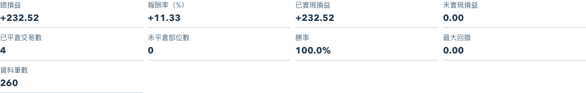

# 第 9 章　讀懂回測報告

繁體中文 · [简体中文](../zh-CN/09-read-a-backtest-report.md) · [English](../en/09-read-a-backtest-report.md) · [本版目錄](README.md)

先數交易筆數和可用觀測。一筆大獲利很容易掩蓋其他部分的表現。接著看沿途的虧損、未平倉部位與報告採用的成本模型。

| 指標 | 意思 |
| --- | --- |
| 已實現損益 | 已出場交易加總的損益。 |
| 未實現損益 | 截至最後價格仍未出場的部位損益。 |
| 總損益 | 依本報告的成本模型計算，等於已實現加未實現。 |
| 勝率 | 獲利的已平倉交易除以全部已平倉交易，兩平交易也在分母。 |
| 最大回撤 | 累計損益從先前高點跌到後面低點的最大差額，初始 0 也列入。 |
| 報酬率 | 總損益除以畫面提示中的分母，再乘以 100%。 |

手動摘要可用「最高占用資金」當分母。設了保證金的那一邊可能以保證金計入，其餘則按進場價值計入。自動回測批次使用同時持有的最高進場總名目金額。讀不同圖線或摘要的數字時先查提示，尤其有設定保證金時。這些報酬率沒有換算成年率。

*圖 9-1　先查資料和交易筆數，再讀損益與回撤。畫面結果由合成資料計算。*

### 在策略監看操作

1. 開啟已儲存報告，找一筆已結束交易，核對兩邊的數量、進出場時間和損益。
2. 在圖上找同一筆的 IN／OUT 標記，沿線看這筆交易持有期間的變化。最後獲利的交易，中途仍可能有明顯虧損。
3. 若報告有未平倉交易，找只有 IN 的標記，記下未實現損益占總損益多少。沒有報酬率時，查是否缺少可用的進場金額。
4. 比較成本前，確認兩份報告使用同一規則、相同期間及相同部位數量。

### 練習

累計損益依序為 0、+20、+8、+25、+6。期末已實現 +10、未實現 −4。總損益是多少？最大回撤是多少？若分母為 200 呢？

查看參考答案

總損益 +6。最大的高點到後續低點是 25 − 6 = 19。按題目給的分母，報酬率為 `6 ÷ 200 × 100 = 3%`。

---

[上一章 · 跑第一次手動回測](08-run-a-manual-backtest.md) · [本版目錄](README.md) · [下一章 · 配置數量並估計成本](10-position-sizing-and-costs.md)
