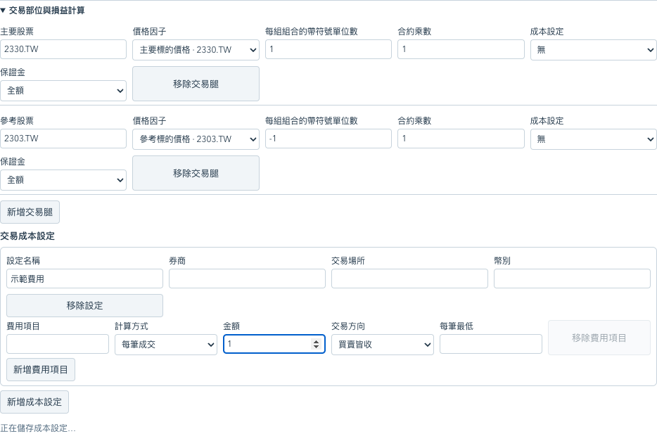

# 第 10 章　配置數量並估計成本

繁體中文 · [简体中文](../zh-CN/10-position-sizing-and-costs.md) · [English](../en/10-position-sizing-and-costs.md) · [本版目錄](README.md)

**訊號避險比率**用於算價差。**數量配置**決定成交模擬時，兩邊各有多少股。更改配置可能改變損益，但不會更改已儲存的價差規則。

| 回測配置 | 兩邊怎麼算 |
| --- | --- |
| 固定數量 | 直接填兩邊的數量。 |
| 依進場價格平衡部位 | 按進場價格與乘數估算參考數量，力求兩邊金額接近，再依數量精度取整。 |
| 依進場時的避險比率 | 畫面提供此選項時，按進場這筆觀測的避險單位數估算參考數量。 |

用第 1 章的示範價格，一股主要股票價值 950 元，19 股參考股票價值也是 950 元。兩邊帶符號的數量是 +1、−19。進場總名目金額是 1,900 元。即使進場金額接近，兩家公司風險仍不同，成交與之後的價格變動也會讓曝險改變。

### 在策略監看操作

1. 用同一規則、期間及欄位跑兩次手動回測，只換**配對數量配置**。找兩次都有的一筆進場，比較兩邊數量、名目金額和損益。若找不到相同交易，也把差異記下。
2. 單獨測手續費時，先儲存不含費用的基準，並固定數量。用停止中的練習策略開啟**策略設定 → 交易部位與損益計算**，如果有**新增成本設定**，新增「示範費用」，計算方式選**每筆成交**、金額填 1，交易方向選**買賣皆收**。金額是教學假設。
3. 分別在兩邊的**成本設定**選「示範費用」，按**套用設定**，再回測同一段期間。比較報告的成本與損益。新增設定後，還要在個別交易腿選用並套用，才會在該策略計入。
4. 記下已套用的費用與報告採用的模型。未計入的借券費或滑價可另行估算，已扣過的費用則不再重算。

*圖 10-1　此設定示範每筆成交收 1 元。接著在兩邊的「成本設定」欄選用。*

**滑價**是預想成交價與實際可能成交價的落差。兩邊成交時間不同時，也可能短暫只持有一邊。報告中的同一筆觀測成交價，可能比實際能取得的價格好。把這些落差當成另一個需要檢驗的假設。

### 練習

一筆完整配對毛利 12 元。四次成交每次費用 1 元，總滑價估 3 元，借券費估 2 元。淨值估計多少？若報告已扣 4 元呢？

查看參考答案

`12 − 4 − 3 − 2 = 3 元`。若報告已扣這 4 元，從 8 元起算，只扣尚未計入的滑價和借券費。

---

[上一章 · 讀懂回測報告](09-read-a-backtest-report.md) · [本版目錄](README.md) · [下一章 · 用未看過的期間檢驗規則](11-test-unseen-periods.md)
