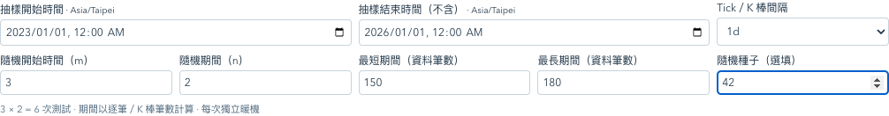
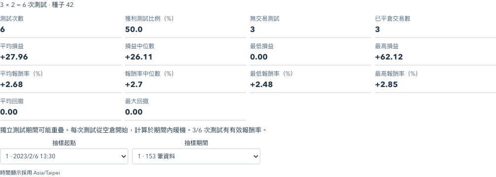

# 第 11 章　用未看過的期間檢驗規則

繁體中文 · [简体中文](../zh-CN/11-test-unseen-periods.md) · [English](../en/11-test-unseen-periods.md) · [本版目錄](README.md)

先用較早的**建模期間**選定配對、權重和門檻。把規則固定後，再看較晚的**保留期間**。若看完較晚的結果才反覆調參數，這段時間也成了選規則的一部分。想再獨立檢驗時，就另找更新且未用過的資料。

### 在策略監看操作

1. 選兩段時間先後相接但互不重疊的歷史資料，確保各自有足夠暖機資料。用相同來源跑較早一段，儲存報告。
2. 將設定和欄位寫進筆記，保持規則、數量、成本不變，再用**手動**跑較晚期間。比較交易筆數、損益和最大回撤。記下結果是否仰賴單一交易。
3. 切到**自動**看看結果是否受期間選擇影響。小型練習可用 **m = 3、n = 2**，指定可容納的資料筆數區間（歷史夠長時例如 150–180 筆），種子填 **42**。抽樣範圍要有足夠長度以容納最長樣本。執行並儲存這批自動回測。
4. 看獲利測試的比例、無交易數、中位損益與最差回撤。用抽樣開始時間與期間下拉選單，分別找一筆較好和一筆較弱的結果，查出至少一個差異。

*圖 11-1　三個起點乘兩種長度，共六次。每一次由空倉起算，重新暖機。*

*圖 11-2　比較多個視窗的分布，再查表中較弱的個別結果。畫面使用合成資料。*

視窗可能重疊，結果不能相加或複利當成一個投資組合。相同種子要配合同一份資料與設定才能重現抽樣。沒有進場的測試在損益分布計入 0，報酬率則是不可用。記錄種子、日期、來源與報告。

### 練習

六個測試是兩個賺、兩個虧、兩個沒交易。獲利測試比例是多少？六個測試若互相重疊，可以當成六份獨立證據嗎？

查看參考答案

比例是 `2 ÷ 6 ≈ 33.33%`。沒有交易的兩個測試沒有可用報酬率。重疊的期間重複使用觀測，六個結果不足以代表六份獨立證據。

---

[上一章 · 配置數量並估計成本](10-position-sizing-and-costs.md) · [本版目錄](README.md) · [下一章 · 模擬監看與期末報告](12-paper-monitoring-and-capstone.md)
