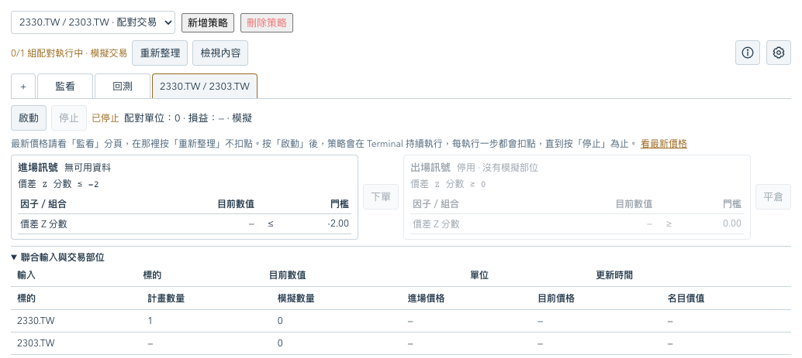

# 第 12 章　模擬監看與期末報告

繁體中文 · [简体中文](../zh-CN/12-paper-monitoring-and-capstone.md) · [English](../en/12-paper-monitoring-and-capstone.md) · [本版目錄](README.md)

回測用以前的資料重放規則。**模擬監看**讓你看到規則如何隨資料更新，並記下遇到的狀況。先規劃一段短時間的觀察。如果原策略有要保留的模擬部位，可以另外建立一個策略做練習。

### 在策略監看操作

1. 在**監看**重新整理，確認兩檔代碼與資料時間。寫下預定開始及停止時間，並檢查持續更新的點數。
2. 打開台積電／聯電配對，在要做模擬練習時按**啟動**。看資料狀態與訊號是否就緒。觀察期間沒有符合條件的訊號，也可以記錄「未觸發」，照原計畫結束。
3. **下單**可用時，會開啟模擬委託單。送出模擬單前逐邊核對價格、數量。要結束部位時，在執行中且資料可用時選**平倉**。**停止**只停止持續計算，會保留尚未平倉的模擬數量。要查最新價格時，用**監看 → 重新整理**即可。
4. 留下模擬成交紀錄或寫下為何沒有執行。若畫面顯示資料過期，先檢查是否休市或來源中斷，記下它對這次觀察的影響。

*圖 12-1　停止的是持續監看。若有模擬部位，請另外確認是否已收到平倉紀錄。*

### 期末實作

填一份[實驗紀錄表](appendix.md)。包括兩檔理由與放棄條件、基準設定、一個建模期間、一個較晚保留期間，以及模擬監看紀錄。列出可用資料、暖機、損益和回撤，說明成本與成交假設。至少寫下一項可能讓結果失真的因素。最後從「繼續研究」「修改後再測」「放棄這組配對」選一項，並引用紀錄說明理由。證據支持放棄時，同樣完成實作。

### 練習

按了「停止」後，模擬數量仍有數字而且不等於 0。這筆部位平倉了嗎？

查看參考答案

尚未平倉。記錄已停止的狀態、兩邊數量、最後資料是否可用，以及預計處理時間。要確認結束部位，另外檢查平倉成交與最終數量。

---

[上一章 · 用未看過的期間檢驗規則](11-test-unseen-periods.md) · [本版目錄](README.md) · [下一章 · 估計避險比率](13-estimate-the-hedge-ratio.md)
