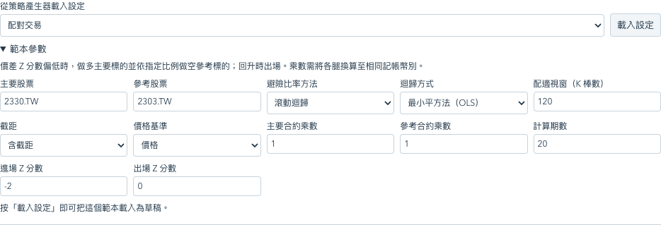

# 第 13 章　估計避險比率

繁體中文 · [简体中文](../zh-CN/13-estimate-the-hedge-ratio.md) · [English](../en/13-estimate-the-hedge-ratio.md) · [本版目錄](README.md)

固定比率容易驗算。估計法則試著配出 **主要價值 ≈ 截距 + 比率 × 參考價值**。比率會受到標的順序、價格或對數價格、以及使用時段的影響。較新的配對範本可選以下方法。

| 方法 | 何時改變比率 |
| --- | --- |
| 固定比率 | 一直用填入的值，直到手動修改。 |
| 靜態配適 | 報告可顯示全期擬合結果，交易仍用已存比率。擬合出的比率可另外填入，放到之後的期間測試。 |
| 滾動迴歸 | 每筆觀測按最近的估計視窗重算。OLS 讓主要價值方向的誤差平方和較小。正交迴歸（TLS）沿所用尺度中的點雲主方向擬合。 |
| 卡爾曼濾波 | 先用一段資料做初始擬合，再隨新觀測逐步調整。漂移設定影響調整快慢。 |

以價格為基礎，正比率可解讀成每個主要單位需要的大約參考單位數，前提是已使用各邊乘數後的價值。以對數價格為基礎，比率衡量相對變動敏感度，要用當筆兩邊價值換算數量。例如比率 1.2、主要價值 60、參考價值 150，對應 `1.2 × 60 ÷ 150 = 0.48` 個參考單位。估計缺失或非正時，可能無法按此方式建立部位。

### 在策略監看操作

1. 保留原固定比率作基準。選**靜態配適**，先使用原本已存的比率跑較早期間。若報告有全期擬合值，記下估計值、基礎與標的順序。
2. 將擬合值填進設定、載入並套用，測較晚期間。若估計值用了整段資料，回頭套用到同一段較早觀測，就會偷看到未來。
3. 另跑一組**滾動迴歸**，保持市場、資料、期間和其他設定一致。**配適視窗（K 棒數）**用來配出關係，**計算期數**用於價差 Z 分數。兩者分別記錄。資料太短時，先增加可用歷史。
4. 若要比較 TLS 或卡爾曼，每次只改一個估計方法，按第 11 章比較較晚的期間。

*圖 13-1　配適視窗和 Z 分數計算期數是不同欄位。*

### 練習

用一到六月擬合出比率，再拿它回測三月，有什麼問題？

查看參考答案

三月的模擬交易用到四到六月尚未發生的資料，屬於前視偏誤。改用六月之後的較晚期間，或用每筆只看當時已知資料的滾動方法。

---

[上一章 · 模擬監看與期末報告](12-paper-monitoring-and-capstone.md) · [本版目錄](README.md) · [下一章 · 檢查配對關係是否站得住](14-assess-the-relationship.md)
