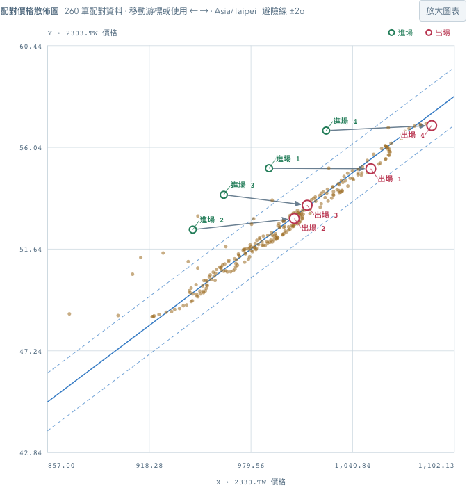

# 第 14 章　檢查配對關係是否站得住

繁體中文 · [简体中文](../zh-CN/14-assess-the-relationship.md) · [English](../en/14-assess-the-relationship.md) · [本版目錄](README.md)

價格散佈圖把同一筆觀測的兩檔價格畫在一張圖上。橫軸是主要價格，縱軸是參考價格。點雲集中時，表示樣本內的價格可能貼近某種關係。先讀提示確認畫的是哪種擬合，以及使用什麼期間。報告擬合線或期末估計描述該期間，歷史交易應使用當時已知的設定或估計值。

*圖 14-1　核對兩軸與擬合方式，再沿交易標記找進出場觀測。圖中為合成資料。*

| 診斷 | 要問的問題 |
| --- | --- |
| R² | 在樣本中，擬合關係解釋了主要序列多少變動？共同趨勢也可能讓 R² 很高。 |
| 殘差標準差 | 相對於擬合關係，價差通常偏離多少？單位會隨價格或對數基礎改變。 |
| 半衰期 | 依模型，偏離縮小一半約需幾筆觀測？無法估計可能因資料不足，或模型下看不出收回。 |
| 共整合 p 值 | 在模型假設下，樣本對「殘差非定態」的虛無假設有多少反證？較小的值只對此次樣本提供證據。 |

**共整合**研究的是，各自呈現非定態的序列，是否存在一個組合具有定態的統計行為。這裡可先理解成組合的變動特性在模型下維持穩定。畫面提供 Engle–Granger 類型的殘差檢定。若反覆查看很多配對和區間，偶然遇到看似有力的數字也更容易。用較晚資料檢驗固定規則，仍是必要的下一步。[Engle 與 Granger](https://users.ssc.wisc.edu/~behansen/718/EngleGranger1987.pdf) · [MacKinnon](https://qed.econ.queensu.ca/working_papers/papers/qed_wp_0861.pdf)

### 在策略監看操作

把建模與保留報告的散佈圖、避險估計和損益放在一起看。可以在線條中選避險比率或殘差相關欄位。挑一次比率明顯變動、或持有很久仍虧損的交易，查明日期。可能與財報、市場、資料問題有關，也可以保留「目前無法判斷」的結論。筆記中把觀測與解釋分開寫。

### 練習

建模期間 R² 為 0.95，共整合 p 值為 0.03。到了保留期間，比率明顯改變、半衰期無法估計，最久的一筆模擬交易仍虧損。你的報告怎麼寫？

查看參考答案

建模期間看起來擬合良好，但較晚資料未確認同一條關係和規則足夠穩定。寫出彼此牴觸的證據、是否有資料問題，並說明是放棄此配對，或提出一個另行檢驗的新假設。

---

[上一章 · 估計避險比率](13-estimate-the-hedge-ratio.md) · [本版目錄](README.md) · [下一章 · 公式、詞彙與實驗紀錄](appendix.md)
